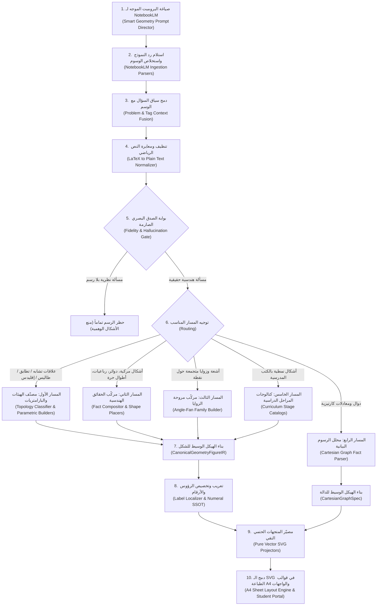

# التقرير المعماري والتشغيلي الشامل: نظام تحويل ردود الذكاء الاصطناعي (NotebookLM) إلى أشكال هندسية ورسوم بيانية

> **تاريخ التقرير:** نوفمبر 2026  
> **نطاق التقرير:** محرك الهندسة البارامتري، مصيّر الرسوم البيانية، محرك الإحصاء، وبوابة الصدق البصري في منصة الرياضيات (`Math Platform`).  
> **حالة الاختبارات الحالية:** 692 اختباراً ناجحاً بنسبة 100% (`58 Test Files Passed`).

---

## فهرس التقرير
1. [المقدمة والفلسفة الهندسية الحاكمة (The Zero-DSL Philosophy)](#1-المقدمة-والفلسفة-الهندسية-الحاكمة)
2. [دورة الحياة الكاملة خطوة بخطوة من البداية إلى النهاية (The Complete End-to-End Pipeline)](#2-دورة-الحياة-الكاملة-خطوة-بخطوة)
3. [ما هو موجود بالفعل ومُفعّل في النظام (Currently Implemented & Active)](#3-ما-هو-موجود-بالفعل-ومفعل-في-النظام)
4. [ما هو مطلوب تطويره وسد ثغراته (Gaps & Required Developments)](#4-ما-هو-مطلوب-تطويره)
5. [ما هو زيادة عن اللزوم وهندسة فائقة بلا طائل (Overengineered & Redundant)](#5-ما-هو-زيادة-عن-اللزوم)
6. [ما هو كود مهمل أو نادر الاستخدام جداً (Dead Code & Rare Artifacts)](#6-ما-هو-كود-مهمل-أو-نادر-الاستخدام)
7. [جدول المقارنة والتقييم النهائي والتوصيات الاستراتيجية](#7-جدول-المقارنة-والتوصيات-الاستراتيجية)

---

## 1. المقدمة والفلسفة الهندسية الحاكمة

يقوم النظام على مبدأ هندسي حاسم ورد في دستور المنصة (`AGENTS.md`): **«حظر DSL والكود في برومبتات الذكاء الاصطناعي (Zero-DSL Policy)»**.
النموذج اللغوي (NotebookLM) لا يُطلب منه أبداً رسم أشكال عبر لغات برمجية (كـ SVG أو Canvas أو HTML أو GeoGebra Script)، لأن النماذج اللغوية تفشل كارثياً في حساب الإحداثيات وتداخل الأطوال وتفترض نسباً بصرية مشوهة.

بدلاً من ذلك، يتحدث النموذج باللغة **العربية الطبيعية الواضحة كحقائق رياضية مجردة**:
- للأشكال الهندسية: `[رسم هندسي: مثلث أ ب جـ قائم في ب ؛ أ ب = 6 سم ؛ ب جـ = 8 سم]`
- للرسوم البيانية: `[رسم بياني: ص = س² - 4 ؛ المدى س من -3 إلى 3]`

ويتولى المحرك الحتمي المكتوب بلغة TypeScript بالكامل في الخادم والواجهة تحليل هذه العبارات، حل معادلاتها الهندسية بدقة متناهية، وبناء كود متجهات SVG نقي 100% صالح للعرض على الشاشة والطباعة الفائقة على ورق A4.

---

## 2. دورة الحياة الكاملة خطوة بخطوة (من الكلمة إلى الـ SVG)

يمر كل نص صادر من NotebookLM برحلة من **10 محطات هندسية متتالية** حتى يظهر كشكل هندسي ناصع في المذكرة أو الامتحان:

---

### المحطة 1: صياغة البرومبت وتوجيه الإخراج الذكي
- **الملف المسؤول:** [`smart-geometry-prompt-director.ts`](file:///F:/Academy%20App/Academy%20APP/Math%20Platform/src/core/prompts/smart-geometry-prompt-director.ts)
- **كيف يعمل؟**
  يقوم النظام بفحص عنوان الدرس والفرع الرياضي:
  - إذا كان الدرس هندسة مستوية أو فراغية أو تشابه، يحقن تلقائياً توجيهاً مضغوطاً جداً في برومبت NotebookLM:
  > *"📐 توجيه الإخراج الهندسي الذكي: للشكل فقط اكتب `[رسم هندسي: ...]` كحقائق بـ `;` بلا كود: الرؤوس (مثلث أ ب جـ قائم في ب|ABCD ~ EFGH)؛ أطوال الأضلاع مع قيمها ووحداتها (أ ب=6 سم)؛ قياسات الزوايا الدقيقة (ق(∠ب)=60°;د هـ // ب جـ;أ د ⊥ ب جـ). ممنوع وسم عائم بلا رؤوس؛ الأسئلة النظرية بلا وسم. وللدوال: `[رسم بياني: ص=٢س+١]`."*
  - **القاعدة الذهبية:** لا يتجاوز هذا التوجيه 350 حرفاً لتوفير مساحة الـ Context Window.

---

### المحطة 2: استلام الرد واستخلاص الوسوم
- **الملفات المسؤولة:** 
  - [`notebooklm-booklet-stages-merger.ts`](file:///F:/Academy%20App/Academy%20APP/Math Platform/src/core/ingestion/notebooklm-booklet-stages-merger.ts)
  - [`notebooklm-exam-questions-parser.ts`](file:///F:/Academy%20App/Academy%20APP/Math Platform/src/core/ingestion/notebooklm-exam-questions-parser.ts)
  - [`notebooklm-worksheet-parser.ts`](file:///F:/Academy%20App/Academy%20APP/Math Platform/src/core/ingestion/notebooklm-worksheet-parser.ts)
- **كيف يعمل؟**
  - يقوم المحلل بالبحث عن التعبير النمطي: `/(?:###?\s*)?\[\s*رسم\s*(?:هندسي|توضيحي|بياني)\s*:\s*([^\]]+)\]/i`.
  - إذا وُجد الوسم، يتم سحبه في متغير `geometryRaw`.
  - وفي نفس الوقت، يفحص إن كان السؤال يشير ضمناً إلى وجود رسم بعبارات مثل: *"في الشكل المقابل"*، *"من الشكل المجاور"*، *"مستعيناً بالشكل الموضح"*.

---

### المحطة 3: دمج سياق نص المسألة مع وسم الرسم (Context Fusion)
- **الملف المسؤول:** [`problem-geometry-context-extractor.ts`](file:///F:/Academy%20App/Academy%20APP/Math Platform/src/core/geometry-engine/description-intake/problem-geometry-context-extractor.ts)
- **لماذا هذه الخطوة حيوية؟**
  في كثير من الأحيان، يكتب NotebookLM وسماً ناقصاً مثل: `[رسم هندسي: مثلثان متشابهان]`، وتكون الأرقام والرؤوس مذكورة في نص السؤال نفسه!
- **كيف يعمل الدمج؟**
  - دمج `geometryRaw` مع `promptAr`.
  - استخراج علاقات التشابه: `ΔABC ~ ΔDEF` أو `مثلث أ ب جـ يشابه مثلث د هـ و`.
  - استخراج الرؤوس بالترتيب التناظري الدقيق (لأن ترتيب الحروف يحدد أي زاوية تساوي أي زاوية وأي ضلع يناظر الآخر).
  - استخراج أطوال الأضلاع سواء كانت رقمية (`6 سم`) أو جبرية بدلالة مجهول (`x + 2 سم` أو `٢س - ١ سم`).
  - استخراج الزوايا والتوازي (`//`) والتعامد (`⊥`) والتقاطع (`∩`) والانتماء (`∈`).

---

### المحطة 4: تنظيف ومعايرة النص الرياضي ولاتيك
- **الملف المسؤول:** [`geometry-latex-to-plain-normalizer.ts`](file:///F:/Academy%20App/Academy%20APP/Math Platform/src/core/geometry-engine/description-intake/geometry-latex-to-plain-normalizer.ts)
- **كيف يعمل؟**
  يقوم بتجريد أكواد LaTeX التي قد يكتبها الذكاء الاصطناعي ويحولها إلى رموز هندسية نقية:
  - `\Delta ABC` $\rightarrow$ `Δ ABC`
  - `\sim` $\rightarrow$ `~`
  - `\cong` $\rightarrow$ `≅`
  - `\parallel` أو `//` $\rightarrow$ `//`
  - `\perp` $\rightarrow$ `⊥`
  - `\angle` أو `\angle{B}` $\rightarrow$ `∠B`
  - `\frac{a}{b}` $\rightarrow$ `a/b`
  - تحويل الأرقام المشرقية (`١، ٢، ٣`) إلى صيغة قياسية موحدة للمعالجة الحسابية.

---

### المحطة 5: بوابة الصدق البصري الصارمة (Zero-Hallucination Fidelity Gate)
- **الملف المسؤول:** [`geometry-figure-fidelity-gate.ts`](file:///F:/Academy%20App/Academy%20APP/Math Platform/src/core/geometry-engine/verification/geometry-figure-fidelity-gate.ts)
- **هذا المكون هو صمام الأمان لمنع تخريف الذكاء الاصطناعي:**
  1. **حجب الرسم عن الأسئلة النظرية:** إذا كان السؤال نظرياً عاماً لا يحتوي على أي رؤوس أو أطوال (مثل: *"إذا تشابه مثلثان فإن النسبة بين مساحتيهما تساوي..."*)، تقوم البوابة **بحجب الرسم فوراً** وإرجاع `undefined` حتى لا يظهر رسم وهمي في السؤال.
  2. **فحص صدق الرؤوس (Vertices Check):** إذا كان السؤال يتحدث عن المثلث $ABC$ والشكل المقترح يحتوي على رؤوس $XYZ$ لم تُذكر في المسألة $\rightarrow$ يُرفض الشكل فوراً.
  3. **فحص الأرقام والبطاقات (Labels Check):** يُمنع منعاً باتاً ظهور أي رقم (مثل `10 سم` أو `40°`) على أضلاع الشكل ما لم يكن مذكوراً نصاً في معطيات المسألة.

---

### المحطة 6: توجيه المسار وبناء الشكل البارامتري (Routing & Synthesis)
إذا اجتاز النص بوابة الصدق، يدخل المنسق العام [`natural-arabic-geometry-matcher.ts`](file:///F:/Academy%20App/Academy%20APP/Math Platform/src/core/geometry-engine/natural-arabic-geometry-matcher.ts) ليختار أفضل مسار توليد:

#### المسار الأول: مصنّف الهيئات المنهجية والتشابه (Curriculum Topology Engine)
- **الملف المسؤول:** [`curriculum-topology-classifier.ts`](file:///F:/Academy%20App/Academy%20APP/Math Platform/src/core/geometry-engine/similarity-family/curriculum-topology-classifier.ts)
- يحلل علاقات المسألة ويصنفها إلى واحدة من **8 هيئات طوبولوجية أساسية للمنهج المصري**:
  1. **`disjoint_two_triangles` (مثلثان منفصلان):** يبنيه [`disjoint-triangles-parametric-builder.ts`](file:///F:/Academy%20App/Academy%20APP/Math Platform/src/core/geometry-engine/similarity-family/disjoint-triangles-parametric-builder.ts) برسم المثلثين متجاورين بنسبة تكبير/تصغير حقيقية وأقواس الزوايا المتناظرة.
  2. **`thales_parallel_in_triangle` (توازي طاليس المتداخل):** يبنيه [`nested-thales-antiparallel-builder.ts`](file:///F:/Academy%20App/Academy%20APP/Math Platform/src/core/geometry-engine/similarity-family/nested-thales-antiparallel-builder.ts) مع وضع أسهم التوازي الدقيقة.
  3. **`antiparallel_in_triangle` (القاطع العكسي):** يبنيه نفس الملف مع عكس ميل القاطع ووضع أقواس تساوي الزوايا ($m(\angle AED) = m(\angle B)$).
  4. **`hourglass_intersecting_chords` (الساعة الرملية وتقاطع وترين/قطعتين):** يبنيه [`hourglass-intersection-parametric-builder.ts`](file:///F:/Academy%20App/Academy%20APP/Math Platform/src/core/geometry-engine/similarity-family/hourglass-intersection-parametric-builder.ts).
  5. **`shared_vertex_secant_triangle` (مثلثان يشتركان في رأس وزاوية):** يبنيه [`shared-angle-and-bisector-builder.ts`](file:///F:/Academy%20App/Academy%20APP/Math Platform/src/core/geometry-engine/similarity-family/shared-angle-and-bisector-builder.ts).
  6. **`adjacent_ray_bisector_triangles` (مثلثان متجاوران بمنصف زاوية):** نفس الملف.
  7. **`euclid_right_triangle_altitude` (إقليدس والعمود من رأس القائمة):** يبنيه [`euclid-altitude-parametric-builder.ts`](file:///F:/Academy%20App/Academy%20APP/Math Platform/src/core/geometry-engine/similarity-family/euclid-altitude-parametric-builder.ts) في أي وضع للقائمة ($A$ أو $B$ أو $C$) مع مربعي التعامد.
  8. **`applied_shadow_height_triangles` (مسائل الظل والارتفاع الحياتية):** يبنيه [`applied-shadow-height-builder.ts`](file:///F:/Academy%20App/Academy%20APP/Math Platform/src/core/geometry-engine/similarity-family/applied-shadow-height-builder.ts) لمسائل الشجرة وسارية العلم وعمود الإنارة.

#### المسار الثاني: المركّب الهندسي الحر بالحقائق المتجهية (Fact Compositor)
- **الملف المسؤول:** [`geo-figure-composer.ts`](file:///F:/Academy%20App/Academy%20APP/Math Platform/src/core/geometry-engine/fact-compositor/geo-figure-composer.ts)
- للمسائل العامة المركبة التي لا تتبع قالباً مغلقاً:
  1. يفكك السطور المفصولة بـ `;` عبر [`geo-fact-parser.ts`](file:///F:/Academy%20App/Academy%20APP/Math Platform/src/core/geometry-engine/fact-compositor/geo-fact-parser.ts).
  2. يحدد المضلعات الأساسية (مثلثات، متوازي أضلاع، مستطيل، شبه منحرف) ويضع إحداثياتها الأولية بواسطة حساب المثلثات والمتجهات في [`geo-shape-placers.ts`](file:///F:/Academy%20App/Academy%20APP/Math Platform/src/core/geometry-engine/fact-compositor/geo-shape-placers.ts).
  3. يحل النقاط المشتقة عبر معادلات المتجهات ثنائية الأبعاد في [`geo-vector-math.ts`](file:///F:/Academy%20App/Academy%20APP/Math Platform/src/core/geometry-engine/fact-compositor/geo-vector-math.ts):
     - نقطة المنتصف (`vMid`).
     - مسقط العمود الهندسي (`footOfPerpendicular`).
     - موقع منصف الزاوية على الضلع المقابل بنسبة الضلعين المجاورين (`angleBisectorFoot`).
     - نقطة تقاطع مستقيمين (`lineIntersection`).
     - علامات التساوي (`tickMarks`) وأسهم التوازي (`parallelArrows`).

#### المسار الثالث: زوايا الأشعة المتجمعة (Angle-Fan Family)
- **الملف المسؤول:** [`angle-fan-figure-builder.ts`](file:///F:/Academy%20App/Academy%20APP/Math Platform/src/core/geometry-engine/angle-fan-family/angle-fan-figure-builder.ts)
- مخصص لمسائل الصف الأول الإعدادي: عدة أشعة تخرج من رأس واحد $M$ أو $O$ مع معطيات التعامد ومجموع الزوايا حول نقطة ($360^\circ$) والمنصفات.

#### المسار الرابع: الرسوم البيانية الكارتيزية للدوال (Cartesian Graphs)
- **الملف المسؤول:** [`graph-fact-parser.ts`](file:///F:/Academy%20App/Academy%20APP/Math Platform/src/core/geometry-engine/graph-compositor/graph-fact-parser.ts)
- يستقبل وسم `[رسم بياني: ...]` ويستخلص:
  - الدوال الخطية: $y = ax + b$ أو $ص = aس + b$.
  - الدوال التربيعية: $y = ax^2 + bx + c$ مع حساب رأس المنحنى $x = -b/(2a)$.
  - دوال المقياس: $y = a|x - h| + k$.
  - الخطوط الأفقية والرأسية: $ص = c$ و $س = a$.
  - النطاق المطلوب: `المدى س من -4 إلى 4`.
  - النقاط المحددة: `(2, 5)`.

---

### المحطة 7: بناء الهيكل البياني الوسيط (Canonical IR)
تُفرز جميع المسارات السابقة في كائن وسيط موحد شديد الصرامة ومستقل تماماً عن أي كود عرض:
- للشكل الهندسي: [`CanonicalGeometryFigureIR`](file:///F:/Academy%20App/Academy%20APP/Math Platform/src/core/ssot/geometry-archetype-ssot.ts)
  - مصفوفة الرؤوس `vertices`: كل رأس له `id` واسم `label` وإحداثيات رقمية `{x, y}`.
  - مصفوفة الأضلاع `segments`: تحدد البداية، النهاية، الطول المكتوب إن وُجد، علامات التساوي، وأسهم التوازي.
  - مصفوفة الزوايا `angles`: الرأس، الضلعان، نوع القوس، علامة الزاوية القائمة المربعة، وقياس الزاوية المكتوب.
- للرسم البياني: [`CartesianGraphSpec`](file:///F:/Academy%20App/Academy%20APP/Math Platform/src/core/ssot/cartesian-graph-spec-ssot.ts)
  - أبعاد الشبكة `{ xMin, xMax, yMin, yMax }`.
  - قائمة الدوال ونقاط التقاطع البارزة.

---

### المحطة 8: تعريب وتخصيص الرموز والأرقام (Localization Layer)
- **الملفات المسؤولة:** 
  - [`numeral-and-unit-ssot.ts`](file:///F:/Academy%20App/Academy%20APP/Math Platform/src/core/ssot/numeral-and-unit-ssot.ts)
  - [`figure-label-symbol-localizer.ts`](file:///F:/Academy%20App/Academy%20APP/Math Platform/src/core/geometry-engine/figure-label-symbol-localizer.ts)
- **كيف يعمل؟**
  - إذا اختار المعلم عرض الرموز باللغة العربية: تتحول الحروف اللاتينية تلقائياً: $A \rightarrow \text{أ}$، $B \rightarrow \text{ب}$، $C \rightarrow \text{جـ}$، $D \rightarrow \text{د}$، $E \rightarrow \text{هـ}$، $M \rightarrow \text{م}$.
  - التحويل بين الأرقام الإنجليزية (`0-9`) والمشرقية (`٠-٩`) ووحدات القياس (`سم`، `م`، `°`).

---

### المحطة 9: مصيّر المتجهات الحتمي النقي (Pure Vector SVG Projector)
- **الملفات المسؤولة:**
  - للهندسة: [`vector-svg-figure-projector.ts`](file:///F:/Academy%20App/Academy%20APP/Math Platform/src/core/geometry-engine/vector-svg-figure-projector.ts)
  - للزوايا: [`vector-svg-angle-projector.ts`](file:///F:/Academy%20App/Academy%20APP/Math Platform/src/core/geometry-engine/vector-svg-angle-projector.ts)
  - للرسوم البيانية: [`graph-svg-projector.ts`](file:///F:/Academy%20App/Academy%20APP/Math Platform/src/core/geometry-engine/graph-compositor/graph-svg-projector.ts)
  - المنسق الموحد: [`question-figure-svg-renderer.ts`](file:///F:/Academy%20App/Academy%20APP/Math Platform/src/core/pdf-layout-engine/question-figure-svg-renderer.ts)
- **كيف يتم الرسم بالرياضيات البحتة؟**
  1. **التحجيم التلقائي وإطار العرض (`Bounding Box Auto-Fit`):**
     يتم إيجاد أدنى وأعلى قيمة لـ $X$ و $Y$ في الشكل، وحساب معامل القياس (`scale`) مع مسافة أمان (`padding = 18px`) ليملأ الشكل كامل مساحة صندوق السؤال دون قص أي تسمية.
  2. **إزاحة الرؤوس الذكية (`Centroid Repulsion`):**
     لحساب موضع حرف الرأس (مثل حرف $A$ أو $\text{أ}$)، يحسب المحرك مركز ثقل الشكل، ويُزيح الحرف في الاتجاه المعاكس للمركز بعيداً عن أضلاع المثلث بمسافة مناسبة ليظل الحرف مقروءاً وخارج الأضلاع.
  3. **أقواس الزوايا الحقيقية (`Trigonometric Arcs`):**
     تُرسم الزاوية القائمة كمربع تعامد هندسي، وتُرسم الزوايا الحادة والمنفرجة كمسار دائري `path` بأقواس متعددة مع كتابة الدرجة في منتصف قوس الزاوية.
  4. **منحنيات الدوال البيانية:**
     تُرسم شبكة إحداثيات رمادية أنيقة مع محوري $X$ و $Y$ وأسهم الاتجاه، وتُحسب نقاط المنحنى بدقة عالية (80 عينة نقطية) لإنتاج خط متصل فائق النعومة (`polyline`).

---

### المحطة 10: إدراج الـ SVG في قوالب الطباعة والواجهات
- **الملفات المسؤولة:**
  - [`a4-vector-html-sheet-renderer.ts`](file:///F:/Academy%20App/Academy%20APP/Math Platform/src/core/pdf-layout-engine/a4-vector-html-sheet-renderer.ts)
  - [`flow-page-geometry-box-layout.ts`](file:///F:/Academy%20App/Academy%20APP/Math Platform/src/core/pdf-layout-engine/flow-page-geometry-box-layout.ts)
- **كيف يظهر في الناتج النهائي؟**
  - يُحقن الـ SVG كعنصر متجهي أصيل داخل بطاقة السؤال إما في الجانب الأيسر مع التفاف نص المسألة حوله، أو ممتداً بعرض مناسب في الأسئلة العريضة.
  - عند الطباعة وتصدير PDF، يُطبع الشكل بجودة طباعية مطلقة (Vector 300+ DPI) ولا يتعرض لأي بكسلة أو تشويه مهما تم تقريب الورقة.

---

## 3. ما هو موجود بالفعل ومُفعّل في النظام

تمتلك المنصة حالياً بنية هندسية متطورة تعد من الأقوى في المنصات التعليمية للرياضيات:

| المكون المنجز | الملفات الرئيسية | حالته الحالية وكفاءته |
|---|---|---|
| **بوابة الصدق البصري وحظر الهلوسة** | [`geometry-figure-fidelity-gate.ts`](file:///F:/Academy%20App/Academy%20APP/Math Platform/src/core/geometry-engine/verification/geometry-figure-fidelity-gate.ts) | مُفعّلة 100%؛ تمنع اختلاق أي رؤوس أو أرقام، وتحجب الرسم عن الأسئلة النظرية العامة. |
| **جامع السياق المزدوج (السؤال + الوسم)** | [`problem-geometry-context-extractor.ts`](file:///F:/Academy%20App/Academy%20APP/Math Platform/src/core/geometry-engine/description-intake/problem-geometry-context-extractor.ts) | مُفعّل 100%؛ يستخرج علاقات التشابه والتطابق حتى لو نسي النموذج وسم الرسم. |
| **محرك التشابه والتطابق البارامتري (8 هيئات)** | [`curriculum-topology-classifier.ts`](file:///F:/Academy%20App/Academy%20APP/Math Platform/src/core/geometry-engine/similarity-family/curriculum-topology-classifier.ts) ومجموعة `builders` التابعة له | مُفعّل 100%؛ يغطي كل حالات تشابه المثلثات، طاليس، إقليدس، القاطع العكسي، الساعة الرملية، والظل والارتفاع. |
| **مركّب مروحة الزوايا (الصف الأول الإعدادي)** | [`angle-fan-figure-builder.ts`](file:///F:/Academy%20App/Academy%20APP/Math Platform/src/core/geometry-engine/angle-fan-family/angle-fan-figure-builder.ts) | مُفعّل 100%؛ يحلل العلاقات الحسابية والتعامد للزوايا المتجمعة حول نقطة والمنصفات. |
| **مركّب الحقائق الهندسية المفتوحة** | [`geo-figure-composer.ts`](file:///F:/Academy%20App/Academy%20APP/Math Platform/src/core/geometry-engine/fact-compositor/geo-figure-composer.ts) | مُفعّل 100%؛ يدعم المثلثات، المستطيلات، المربعات، متوازي الأضلاع، أشباه المنحرف، والدوائر وأوتارها. |
| **مصيّر الدوال الكارتيزية** | [`graph-fact-parser.ts`](file:///F:/Academy%20App/Academy%20APP/Math Platform/src/core/geometry-engine/graph-compositor/graph-fact-parser.ts) و [`graph-svg-projector.ts`](file:///F:/Academy%20App/Academy%20APP/Math Platform/src/core/geometry-engine/graph-compositor/graph-svg-projector.ts) | مُفعّل 100%؛ يرسم الدوال الخطية والتربيعية ودوال المقياس والنقاط المحددة. |
| **مصيّر الـ SVG المتجهي الطباعي** | [`vector-svg-figure-projector.ts`](file:///F:/Academy%20App/Academy%20APP/Math Platform/src/core/geometry-engine/vector-svg-figure-projector.ts) | مُفعّل 100%؛ يدعم علامات التساوي، أسهم التوازي، أقواس الزوايا، التعريب، وتغيير نظام الأرقام. |
| **جناح الاختبارات الآلية الشامل** | 58 ملف اختبار في مجلد `tests/` | **692 اختباراً ناجحاً بنسبة 100%** مع فحص صارم للتراجع وعدم تداخل المراحل. |

---

## 4. ما هو مطلوب تطويره (الفجوات الحقيقية)

على الرغم من قوة المحرك الحالي، هناك **4 فجوات رئيسية** تحتاج إلى تطوير استراتيجي:

### 1. انقطاع محرك الإحصاء عن ردود الذكاء الاصطناعي (غائب تماماً عن دورة الحياة)
- **المشكلة الحالية:**
  يوجد مجلد كامل باسم [`src/core/statistics-engine`](file:///F:/Academy%20App/Academy%20APP/Math Platform/src/core/statistics-engine/) يضم 6 ملفات (المدرج التكراري، المضلع التكراري، المنحنى الصاعد، القطاعات الدائرية، الصندوق وطرفيه).
  **ولكن هذا المحرك معزول 100% ومفصول عن الواقع!**
  - لا يوجد برومبت في [`smart-geometry-prompt-director.ts`](file:///F:/Academy%20App/Academy%20APP/Math Platform/src/core/prompts/smart-geometry-prompt-director.ts) يطلب من NotebookLM توليد جداول إحصائية أو وسوم إحصائية.
  - لا يوجد محلل لوصف الإحصاء (لا يوجد `statistics-fact-parser.ts`).
  - **لا يوجد مصيّر SVG للإحصاء إطلاقاً**؛ كائن [`CanonicalStatisticsDatasetIR`](file:///F:/Academy%20App/Academy%20APP/Math Platform/src/core/ssot/statistics-archetype-ssot.ts) لا يتحول إلى رسم أبداً، وفي [`question-figure-svg-renderer.ts`](file:///F:/Academy%20App/Academy%20APP/Math Platform/src/core/pdf-layout-engine/question-figure-svg-renderer.ts) يتم تجاهل حقل `attachedStatisticsDataset` تماماً!
- **المطلوب تطويره:**
  - إضافة وسم موحد في البرومبت: `[رسم إحصائي: نوع=مدرج تكراري؛ الفئات=10-, 20-, 30-؛ التكرار=6, 12, 18]`.
  - كتابة مصيّر SVG متجهي نقي للرسوم الإحصائية [`statistics-svg-projector.ts`].

### 2. قصور الرسوم البيانية للدوال (دعم الدوال التكعيبية والكسرية والمثلثية)
- **المشكلة الحالية:**
  [`graph-fact-parser.ts`](file:///F:/Academy%20App/Academy%20APP/Math Platform/src/core/geometry-engine/graph-compositor/graph-fact-parser.ts) يدعم فقط: (الخطية، التربيعية، المقياس، الخطوط الأفقية والرأسية).
  إذا أخرج NotebookLM دالة تكعيبية ($f(x) = x^3$)، أو دالة كسرية ($f(x) = \frac{1}{x}$)، أو دالة مثلثية ($y = \sin x$) المقررة على الصفين الأول والثاني الثانوي، يعجز المحلل عن قراءتها ولا يُرسم المنحنى!
- **المطلوب تطويره:**
  - توسيع Regex الدوال ليدعم: $x^3$، الدوال الكسرية البسيطة $\frac{a}{x-h} + k$، والدوال المثلثية الدورية.

### 3. غياب الأشكال الهندسية المرسومة داخل المستوى الإحداثي (الهندسة التحليلية)
- **المشكلة الحالية:**
  محرك الهندسة يرسم الأشكال على مساحة بيضاء دون محاور إحداثية، ومحرك الرسوم البيانية يرسم دوال على محاور دون مضلعات هندسية!
  في منهج الصف الثالث الإعدادي (الهندسة التحليلية): يُطلب كثيراً: *"مثلث رؤوسه $A(1, 2)$، $B(5, 2)$، $C(3, 6)$ على الشبكة التربيعية"*.
- **المطلوب تطويره:**
  - دمج وضع الشبكة الإحداثية داخل المحرك الهندسي (`showCartesianGrid: true`) عند تفعيل فرع الهندسة التحليلية.

### 4. تحسين خط المعادلات على أضلاع الأشكال (Typography in SVG)
- **المشكلة الحالية:**
  عندما يكون طول الضلع مجهولاً جبرياً مركباً مثل $x^2 - 1$ أو $\frac{x+3}{2}$، يُرسم النص كـ SVG Text عادي، مما يجعله يبدو أقل جودة مقارنة بباقي معادلات المسألة المنسقة بـ KaTeX.
- **المطلوب تطويره:**
  - دعم تمثيل الكسور والمربعات بصيغة مصغرة أو استخدام رموز Unicode الرياضية الفائقة لتظهر الكسور الجبرية على الأضلاع بأناقة عالية.

---

## 5. ما هو زيادة عن اللزوم وهندسة فائقة بلا طائل (Overengineered)

في المشروع كود فائق التعقيد تم بناؤه نظرياً لكنه يمثل عبئاً هندسياً زائداً عن حاجة المنصة:

### المحسّن اللاخطي والمصفوفات المقاربة (Levenberg-Marquardt Optimizer)
- **الملفات المسؤولة:**
  - [`geometry-figure-constraint-refiner.ts`](file:///F:/Academy%20App/Academy%20APP/Math Platform/src/core/geometry-engine/constraint-refiner/geometry-figure-constraint-refiner.ts)
  - [`levenberg-marquardt-residual-minimizer.ts`](file:///F:/Academy%20App/Academy%20APP/Math Platform/src/core/geometry-engine/constraint-refiner/levenberg-marquardt-residual-minimizer.ts)
  - [`dense-normal-equations-solver.ts`](file:///F:/Academy%20App/Academy%20APP/Math Platform/src/core/geometry-engine/constraint-refiner/dense-normal-equations-solver.ts)
  - [`figure-constraint-residual-builder.ts`](file:///F:/Academy%20App/Academy%20APP/Math Platform/src/core/geometry-engine/constraint-refiner/figure-constraint-residual-builder.ts)
- **لماذا هو زيادة عن اللزوم؟**
  1. هذا المحرك عبارة عن خوارزمية ذكاء اصطناعي وتحسين عددي وحل معادلات مصفوفية جاكوبية (`Jacobian Matrix`) لحساب إزاحات النقط حتى تتطابق الأطوال المقاسة مع الأطوال المكتوبة.
  2. في التطبيق العملي، تم **قفل هذا المحرك واستبعاده صراحة** من أهم عائلات المنهج (`TOPOLOGY_LOCKED_BRANCH_IDS` في السطر 170 من `natural-arabic-geometry-matcher.ts`):
     > *"الأشكال البارامترية المحكومة طوبولوجياً (طاليس/القاطع العكسي/الساعة الرملية/إقليدس): تحريك رؤوسها لمطابقة الأطوال يكسر استقامة الأضلاع ويُخرج مضلعات ليست مثلثات، فتُترك على بنيتها الصحيحة..."*
  3. الأشكال المدرسية تعتمد على **الهندسة البارامترية المغلقة (Closed-Form Analytical Trigonometry)** التي تحسب النقط مباشرة بدقة متناهية دون الحاجة لخوارزميات تقريب تكرارية تستهلك المعالج وتخاطر بكسر توازي أو استقامة الأضلاع!

---

## 6. ما هو كود مهمل أو نادر الاستخدام جداً في النظام

أكواد موجودة في شجرة الملفات لكنها لا تُستدعى أو تخدم حالات شديدة الندرة:

1. **حزمة محرك الإحصاء بالكامل (`statistics-engine`):**
   - 6 ملفات كاملة لم تُربط أبداً بالـ Intake ولا بـ SVG Renderer، وتُعد حالياً **كوداً ميتاً (Dead Code)** حتى يتم تفعيل مسار الإحصاء المطلوب في البند السابق.
2. **عائلة المجسمات الفراغية الساكنة (`spatial-3d-family`):**
   - [`pyramid-spatial-planes-branch.ts`](file:///F:/Academy%20App/Academy%20APP/Math Platform/src/core/geometry-engine/spatial-3d-family/pyramid-spatial-planes-branch.ts)
   - [`cylinder-cone-sphere-branch.ts`](file:///F:/Academy%20App/Academy%20APP/Math Platform/src/core/geometry-engine/spatial-3d-family/cylinder-cone-sphere-branch.ts)
   - [`cube-cuboid-prism-branch.ts`](file:///F:/Academy%20App/Academy%20APP/Math Platform/src/core/geometry-engine/spatial-3d-family/cube-cuboid-prism-branch.ts)
   - **السبب:** تعيد أشكالاً ثلاثية الأبعاد ثابتة الإحداثيات (Static Wireframes) عند العثور على كلمات مثل "هرم" أو "مخروط"، ولا تستجيب للأبعاد أو الأرقام المتغيرة الواردة في السؤال، مما يجعل استخدامها شبه معدوم في المذكرات الحقيقية.
3. **متجهات قوى الاستاتيكا والمستوى المائل:**
   - [`mechanics-force-vectors-branch.ts`](file:///F:/Academy%20App/Academy%20APP/Math Platform/src/core/geometry-engine/spatial-3d-family/mechanics-force-vectors-branch.ts)
   - تُستدعى فقط بكلمات مثل "مستوى مائل" أو "رد الفعل" في مادة الاستاتيكا للثانوية العامة، وترسم شكلاً ثابتاً غير بارامتري، ونادراً ما تُطلب من NotebookLM.
4. **نموذج مساحة المستطيل للحساب الابتدائي (`arithmetic-area-model`):**
   - [`area-model-arithmetic-svg-builder.ts`](file:///F:/Academy%20App/Academy%20APP/Math Platform/src/core/geometry-engine/arithmetic-area-model/area-model-arithmetic-svg-builder.ts)
   - مخصص فقط لضرب الأعداد في الصف الرابع والخامس الابتدائي بنموذج مساحة المستطيل، ونادراً ما يطلبه المعلم في التوليد الآلي العام.
5. **كتالوجات الأسئلة المدرسية الثابتة القديمة:**
   - عشرات الملفات في مجلد `curriculum-catalogs/` تحتوي على أسئلة نصية منسوخة من كتب قديمة. مع نضج المحرك البارامتري الذكي المفتوح، أصبحت هذه الكتالوجات عبئاً يخشى منه خطف المسائل الجديدة أو التضارب معها.

---

## 7. جدول المقارنة والتقييم النهائي والتوصيات الاستراتيجية

| المحور | الوضع الراهن | التقييم الهندسي | التوصية الحاسمة |
|---|---|---|---|
| **توليد أشكال الهندسة المستوية والتشابه** | بارامتري، حتمي، ذكي، مرتبط ببوابة صدق بصرية صارمة ومطابق لنص السؤال 100%. | **امتياز (9.8 / 10)** | الحفاظ على هذه البنية المعمارية وتوسيعها لتشمل بقية حالات الدوائر والرباعيات بنفس الأسلوب. |
| **توليد الرسوم البيانية للدوال** | يعمل بكفاءة للدوال الخطية والتربيعية والمقياس عبر SVG متجهي نقي. | **جيد جداً (8 / 10)** | دعم الدوال التكعيبية والكسرية والمثلثية في `graph-fact-parser.ts` لتغطية مناهج المرحلة الثانوية. |
| **محرك الإحصاء والرسوم الإحصائية** | كود منفصل من 6 ملفات بلا محلل Intake وبلا مصيّر SVG. | **غير مفعّل (2 / 10)** | بناء `statistics-svg-projector.ts` وربط البرومبت لاستقبال الجداول التكرارية والمدرجات ورسمها. |
| **المحسّن العددي Levenberg-Marquardt** | خوارزمية مصفوفية فائقة التعقيد مقفلة ومستبعدة عملياً في أغلب الحالات الحيوية. | **زيادة عن اللزوم (Overkill)** | عزل المحسّن العددي والاعتماد التام على الحلول البارامترية المغلقة (Closed-Form) لتوفير الأداء والتعقيد. |
| **كتالوجات المراحل الدراسية القديمة** | 20+ ملف ثابت بأسئلة ومقاسات مسبقة الصنع تخاطر بخطف المسائل. | **قابلة للاستبدال (Redundant)** | الاستمرار في ترقية المسائل إلى المحرك البارامتري العام والاستغناء التدريجي عن القوالب المسبقة الصنع. |

---
*تم إعداد هذا التقرير الفني الشامل بناءً على الفحص الحي لكامل ملفات ومحركات شجرة مشروع المنصة.*
