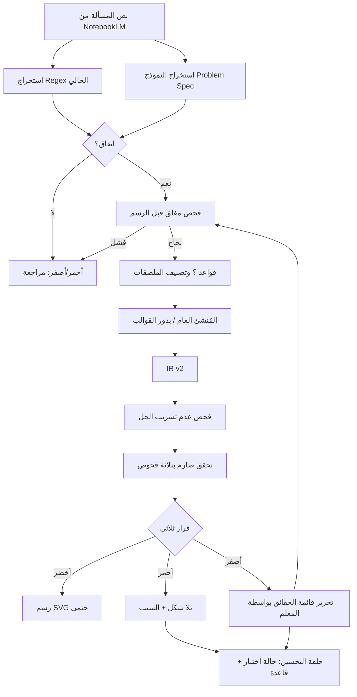
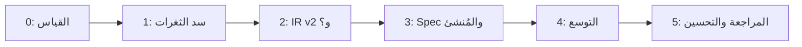

# الخطة الشاملة: تحويل رد NotebookLM إلى شكل هندسي دقيق (Fidelity-First Figure Pipeline)

> **المبدأ الحاكم:** لكل مسألة شكل يحمل **كل معطياتها** و**«؟» للمطلوب**، ولا يحمل شيئاً زائداً ولا يكشف الحل.
> وإن لم يتحقق ذلك **يُرفض الشكل ويُعلَّم للمراجعة** بدل رسم شكل قريب.
> الدقة أهم من التغطية: «لا شكل» أفضل ألف مرة من «شكل خاطئ».

---

## 1. الأهداف ومقاييس النجاح (قابلة للتعديل)

| المقياس | الهدف | طريقة القياس |
|---|---|---|
| دقة ما يُنتَج (أخضر معتمد) | ≥ 99% | مراجعة بشرية على المجموعة الذهبية |
| تغطية المنهج | ≥ 85–90% من المسائل | لوحة التغطية لكل صف/فرع |
| الباقي | يُرفض بوضوح مع السبب | حالة أحمر، صفر رسم خاطئ |
| تسريب الحل على الشكل | 0 | فحص آلي لكل رقم ظاهر |
| تراجع (Regression) | 0 على المجموعة الذهبية | Vitest قبل كل اعتماد |

> لا ضمان 100% في الجانبين (دقة وتغطية)، ومقياس **الدقة هو الأهم** لأن المعلم يعتمد النظام في عمله.

---

## 2. المعمارية العامة (خط الأنابيب)



---

## 3. الطبقات التقنية (التفصيل)

### 3.1 وصف المسألة المنظم (Problem Spec)
يُستخرج من **نص المسألة نفسها** (وليس من وسم `[رسم هندسي: ...]` فقط) في JSON ثابت المخطط:

- **الكائنات:** نقاط، قطع، مضلعات، دوائر، أقواس.
- **العلاقات:** تساوٍ، توازٍ، تعامد، منتصف، منصف، مماس، نقطة على دائرة.
- **المعطيات:** القيمة أو العبارة الجبرية **مع وحدتها**.
- **المطلوب `asked`:** طول | زاوية | مساحة | نسبة | برهان.

سياسة **Zero-DSL** باقية: النموذج يعطي حقائق رياضية فقط، لا كود رسم ولا SVG.

**الاستخراج المزدوج المتوازي:** القواعد الحالية (Regex) + استخراج النموذج؛ **يُعتمد الوصف عند اتفاقهما فقط**، وأي اختلاف ← أصفر/أحمر.

مثال مخطط (توضيحي):
```json
{
  "objects": [{"type":"triangle","vertices":["أ","ب","جـ"]}],
  "relations": [{"type":"perpendicular","at":"ب","of":["أب","بجـ"]},
                {"type":"midpoint","point":"د","of":["أ","ب"]}],
  "givens": [{"target":"أب","value":"6","unit":"سم"}],
  "asked": {"kind":"length","target":"أجـ"}
}
```

### 3.2 الفحص المغلق قبل الرسم (Closed-World Check)
1. **سلامة الرموز:** كل رمز (نقطة/متغير) في الوصف موجود في نص المسألة.
2. **الاكتمال (الفحص المفقود اليوم):** كل رقم هندسي في النص موجود في الوصف.
3. **الاتساق الرياضي:** المتباينة المثلثية، مجموع زوايا المثلث/الرباعي، فيثاغورس، تعارض المعطيات.

أي فشل ← لا رسم.

### 3.3 المُنشئ العام (General Constructor)
بدل مئات القوالب الثابتة:
- ترتيب القيود (Constraint ordering) ثم **وضع كل نقطة بالبناء المباشر**: مثلث بأضلاعه، نقطة على ضلع بنسبة، عمود، منصف، منتصف، مماس...
- ما عجز عنه البناء المباشر يُحَل بـ**المحسّن العددي الموجود** مع **بدايات متعددة** (Multi-start).
- القوالب البارامترية الناجحة (التشابه…) تبقى **بذور تخطيط** (Layout Seeds) لا مصدر حقيقة.

### 3.4 النموذج الوسيط IR v2
إضافات على IR الحالي:
- دائرة وقوس بحق (أكثر من دائرة).
- نص حر على الشكل.
- مناطق مظللة.
- وضع الشبكة الإحداثية.
- مجسمات بأبعاد حقيقية.
- **نوع لكل ملصق:** `given` | `unknown` | `name` — فيُرسم المجهول «؟».

### 3.5 قواعد «؟» (تُحسم قبل البناء)
| نوع المطلوب | موضع «؟» |
|---|---|
| «أوجد طول س ص» | على الضلع، أو المتغير نفسه إن كانت المسألة تستخدم `x` |
| «احسب ق(∠ب)» | داخل القوس |
| المساحة | داخل المنطقة |
| النسبة | على القطعتين |
| البرهان | لا «؟»؛ المعطيات فقط |

### 3.6 فحص عدم تسريب الحل
أي رقم على الشكل **يجب أن يكون معطى في النص**. لا تظهر قيمة محسوبة أبداً (طول/زاوية/مساحة ناتجة).

### 3.7 التحقق الصارم (ثلاثة فحوص)
1. **إعادة قياس** كل معطى من الشكل المرسوم بهامش ضئيل (ε).
2. **كل معطى ظاهر** على الرسم، والمطلوب مُعلَّم.
3. **لا زيادات** (لا ملصق/عنصر غير مذكور).

وإضافة:
- مخالفة الأطوال **خطأ لا تحذير**.
- التفاوت الشديد في الأطوال يُعرض «غير مرسوم بمقياس رسم» بدل رسم مضلل.

### 3.8 القرار بثلاث حالات
| الحالة | المعنى | الإجراء |
|---|---|---|
| 🟢 أخضر | اجتاز كل الفحوص | يُعتمد تلقائياً |
| 🟡 أصفر | نقص/التباس قابل للإصلاح | المعلم يعدّل **قائمة الحقائق** (لا الرسم) ثم يُعاد الفحص |
| 🔴 أحمر | لا يمكن رسمه بدقة | بلا شكل مع **السبب** |

> **ممنوع إطلاقاً:** «مثلث/قطعة واصلة» احتياطي (Fallback) لأي فشل.

### 3.9 الكتالوجات القديمة
**لا تُحذف** (وتبقى متوافقة مع قانون عدم الكود الميت: لا تُعاد كتابتها بنسخة موازية). تتحول إلى:
- **مجموعة اختبار ذهبية** (مسألة + شكلها الصحيح) تضمن عدم التراجع.
- **مسار سريع (Fast Path)** فقط عند **مطابقة قوية ومتحقق منها** بنفس الفحوص.

### 3.10 المرحلة الابتدائية
توليدات خاصة تستخدم **نفس المسار**: مستطيل ومربع بالأبعاد، مضلعات مركبة (شكل L)، تصنيف الزوايا والمثلثات، خط الأعداد، الكسور، الأعمدة والصور البيانية، والدائرة للصف السادس.

### 3.11 حلقة التحسين
كل فشل أو تصحيح من المعلم ← **حالة اختبار + قاعدة جديدة**. لوحة مراقبة: تغطية المنهج، ونسب الأخضر/الأصفر/الأحمر، وأسباب الرفض الأكثر تكراراً.

---

## 4. المراحل التنفيذية

### المرحلة 0 — القياس أولاً (Baseline)
- **المهام:** جمع 300–500 مسألة حقيقية لكل صف من الكتب مع الشكل الصحيح؛ بناء لوحة التغطية؛ قياس الوضع الحالي (كم يُرسم صح/خطأ/لا شيء).
- **المخرجات:** المجموعة الذهبية v1، لوحة تغطية، تقرير خط الأساس.
- **معيار الإنجاز:** رقم موثق لدقة النظام الحالي وتغطيته لكل صف.
- **ملاحظة:** بدونها لا نعرف أين نحن فعلاً ولا نستطيع إثبات التحسن.

### المرحلة 1 — سد الثغرات الخطرة (Stop the Bleeding)
- إيقاف القوالب الثابتة (تُرجع «لا شكل» لحين استبدالها).
- تشديد البوابة بفحص الاكتمال (3.2).
- رفع مخالفة الأطوال إلى خطأ.
- إصلاح الوحدات.
- إيقاف الدالة الاحتياطية (المثلث/القطعة الواصلة).
- **معيار الإنجاز:** صفر أشكال خاطئة معروفة على المجموعة الذهبية (حتى لو انخفضت التغطية).
- **مخاطرة:** انخفاض مؤقت في التغطية ← مقبول ومعلن للمالك.

### المرحلة 2 — IR v2 و«؟» وفحص التسريب
- بناء IR v2 (3.4)، قواعد «؟» (3.5)، فحص التسريب (3.6)، التحقق الصارم (3.7)، القرار الثلاثي (3.8).
- ثم **إعادة بناء الدوائر والمجسمات** عليه.
- **معيار الإنجاز:** لا تسريب حل على المجموعة الذهبية؛ كل مجهول يُرسم «؟».

### المرحلة 3 — Problem Spec والمُنشئ العام
- مخطط JSON ثابت، الاستخراج المزدوج، فحوص الاتساق، المُنشئ العام بالبناء المباشر + المحسّن متعدد البدايات.
- نقل التغطية من «الحفظ» إلى «الفهم».
- **معيار الإنجاز:** ارتفاع التغطية مع بقاء الدقة ≥ 99% على الذهبية.

### المرحلة 4 — التوسع بالمواد
بالترتيب: **الابتدائي** ← **الإحصاء** ← **الدوال** ← **الإحداثيات**، كلٌّ عبر نفس المسار.

### المرحلة 5 — واجهة المراجعة وحلقة التحسين
- واجهة للمعلم (جوال أولاً 360px، أزرار ≥ 44px): عرض الأصفر/الأحمر، تحرير قائمة الحقائق، إعادة الفحص.
- ربط كل تصحيح بإنشاء حالة اختبار ذهبية تلقائياً.
- لوحة المراقبة (3.11).

---

## 5. الالتزام بالدستور (AGENTS.md)
- **ذرية الملفات:** كل خاصية فرعية (استخراج، فحص اكتمال، فحص تسريب، قواعد «؟»…) في ملف مستقل باسم فريد، ≤ 300 سطر.
- **SSOT:** أنواع المطلوب والعلاقات تُعرَّف في مصدر واحد (`geometry-archetype-ssot.ts`) دون تكرار.
- **Zero-DSL** و**Zero AI Branding** في الواجهات والمطبوعات.
- **قبل كل مرحلة:** بحث في الشجرة ← قراءة الملف الموجود ← حذف الكود المستبدل بعد التحقق (`grep` + `npx tsc --noEmit`) ← Vitest ← `git push origin main`.
- **بوابة التوقف:** أي خطوة تهدد ميزة قائمة (مثل إيقاف القوالب في المرحلة 1) تتطلب تأكيد المالك قبل التنفيذ.

---

## 6. المخاطر والمعالجة

| الخطر | الأثر | المعالجة |
|---|---|---|
| هلوسة النموذج في Problem Spec | وصف خاطئ | استخراج مزدوج + فحص مغلق |
| انخفاض التغطية بعد التشديد | رفض مسائل كثيرة | المرحلة 3 ترفع التغطية؛ المعلم يصلح الأصفر |
| مسائل غير قابلة للبناء | فشل المحسّن | بدايات متعددة ثم أحمر مع سبب |
| تضخم المجموعة الذهبية | بطء الاختبارات | تقسيم بحسب الصف/الفرع |
| ملصقات تكشف الحل | خطأ تعليمي | فحص التسريب إلزامي |

---

## 7. الجدول الزمني التقريبي (ترتيب لا تواريخ)


## 8. تعريف «تم» للمشروع
- دقة ≥ 99% على الذهبية بمراجعة بشرية.
- تغطية ≥ 85–90%.
- صفر تسريب حل، وصفر شكل احتياطي.
- كل مرفوض موثق بسببه، وكل تصحيح يتحول إلى اختبار.
