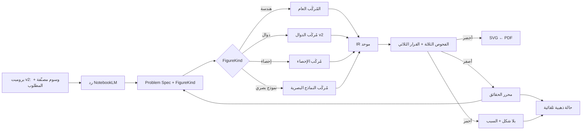
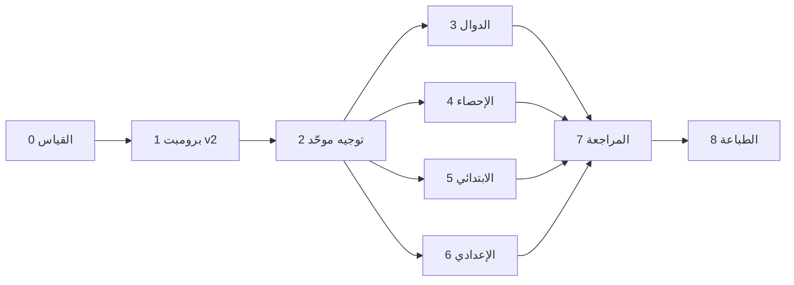

# خطة تحسين منظومة الأشكال والرسوم لتغطية المرحلتين الابتدائية (3–6) والإعدادية (1–3)

> **المرجع التحليلي:** [`geometry-system-full-analysis-report.md`](./geometry-system-full-analysis-report.md) (رموز الفجوات `G-1…G-14` تشير إليه).
> **المبدأ الحاكم:** «لا شكل» أفضل من «شكل خاطئ». الدقة قبل التغطية.

## 0. قرارات المالك المعتمدة (6 نوفمبر 2026)

| # | القرار | الأثر على الخطة |
|---|---|---|
| D-1 | **لا صف أول ولا ثانٍ ابتدائي** (لا هندسة فيهما أصلاً وهي غير موجودة في المراحل الأعلى) | النطاق = ابتدائي 3–6 + إعدادي 1–3. **لا تعديل على `EGYPTIAN_MATH_GRADES_SSOT`.** |
| D-2 | **الموافقة على تحويل الكتالوجات الثابتة** إلى بذور/مسار سريع محقَّق | المرحلة 2 معتمدة؛ انخفاض مؤقت في التغطية مقبول. |
| D-3 | **حذف الكود الميت والتقرير القديم** | ✅ **نُفِّذ**: حُذفت ملفات `statistics-engine/*-branch.ts` الخمسة و`statistics-dataset-root-core.ts` وتقرير `geometry-and-charts-pipeline-audit-report.md` بعد `grep` شامل و`tsc` ناجح. |
| D-4 | **البدء بالتوصية: المراحل 0 ← 1 ← 2 ثم الابتدائي** | ترتيب التنفيذ في القسم 5. |
| D-5 | **البيانات المتاحة هي ما في المستودع فقط** (لا كتب ولا ردود إضافية) | قيد حاكم: انظر القسم 1. |

---

## 1. قيد البيانات وكيف نتعامل معه

لا توجد لدينا كتب ولا ردود NotebookLM إضافية. المتاح: **375 حالة ذهبية** (`tests/golden-corpus/geometry/*.json`) + حالات الاختبارات + نصوص الكتالوجات (التي تحمل أمثلة مصاغة من الكتب). لذلك لا نخمّن مناهج؛ نعتمد أربع آليات:

1. **توسيع آلي بالتحويلات الصامدة (Metamorphic):** من كل حالة ذهبية نشتق متغيرات (تبديل أسماء الرؤوس، تغيير الأرقام بما يحفظ الاتساق، التبديل عربي↔إنجليزي، إعادة ترتيب الحقائق). **الشكل الصحيح لا يتغير جوهرياً** ⇒ نكتشف الهشاشة بلا حاجة لكتب.
2. **أداة جرد تعمل عند المعلم:** برومبت لـ NotebookLM يُشغَّل على مصادر المعلم نفسه (كتبه) فيُخرج «جرد الأشكال» بصيغة منظمة، يحلله النظام ويُنتج قائمة `Archetypes` معتمَدة. أي أن بيانات المنهج الحقيقية تُجمع عبر الاستخدام لا عبر تخميننا.
3. **حلقة التصحيح:** كل شكل أصفر/أحمر يصححه المعلم يتحول حالة ذهبية (المرحلة 7). الذهبية تنمو مع العمل الفعلي.
4. **المراجعة البشرية الموجَّهة:** واجهة ✓/✗ سريعة على الأشكال الخضراء (جوال أولاً) لتثبيت رقم الدقة.

> [!IMPORTANT]
> أي قائمة أشكال في القسم 4 **مقترحة** إلى أن يعتمدها المعلم عبر الجرد (المهمة 0.3). لا يُبنى مُنشئ جديد لشكل غير موجود في الجرد المعتمد إلا إذا ظهر في ردود حقيقية.

---

## 2. الأهداف القابلة للقياس (KPIs)

| المقياس | الحالي | الهدف |
|---|---|---|
| الدقة المثبتة بشرياً (للأخضر) | غير معروفة | ≥ 99% |
| التغطية (تستحق شكلاً ورُسمت) | ≈ 73% | ≥ 90% لكل صف |
| أشكال من كتالوج بلا فهم للمسألة | 109 (≈ 40%) | < 20% ثم 0 كمصدر حقيقة |
| تسريب حل / شكل لمسألة نظرية | 0 | يبقى 0 |
| صفوف/أنواع خارج القياس | ابتدائي 3 و5، دوال، إحصاء إعدادي، مجسمات، دوائر | 0 |
| حالات ذهبية (مع المشتقة آلياً) | 375 | ≥ 1,500 |
| زمن `vitest` الكامل | ≈ 7 ث | ≤ 30 ث |

---

## 3. المعمارية المستهدفة

التغيير الجوهري: **`FigureKind` حقل صريح** يُحدَّد قبل التوجيه (من نوع الوسم + Problem Spec) بدل التخمين بالكلمات المفتاحية، ومسار واحد لكل الأنواع بنفس الفحوص.

### قواعد التنفيذ لكل مهمة (من الدستور)
- ملف ذري باسم فريد عالمياً ≤ 300 سطر؛ SSOT واحد لكل تعريف.
- بحث ← قراءة الموجود ← حذف المستبدَل بعد `grep` + `npx tsc --noEmit`.
- `npx vitest run` كامل ناجح ← `git add/commit/push origin main` بعد كل مهمة مكتملة.
- مهمة تهدد ميزة قائمة ⇒ توقف وتأكيد المالك (المادة 7).
- **شرط عدم الارتداد:** لا تُدمج مهمة إن زاد عدد حالات `wrong_figure` أو انخفضت الحالات الخضراء المعتمدة على الذهبية.

---

## 4. المراحل والمهام التفصيلية

> الرموز: **[ك]** يغيّر الكود · **[ب]** بيانات/اختبارات · **[و]** وثائق · **[م]** يحتاج تأكيد المالك · 🔗 اعتماد على مهمة أخرى.

### المرحلة 0 — القياس والبنية التحتية للجودة · يعالج G-2, G-14
**الهدف:** رقم دقة حقيقي ومجموعة ذهبية قابلة للمقارنة الآلية.

| المهمة | الوصف | الملفات المقترحة | معيار القبول |
|---|---|---|---|
| **0.1 [ك,ب]** | إضافة `expectedFigureSpec` اختياري لحالة الذهبية (رؤوس، أطوال معروضة، زوايا معروضة، موضع «؟») ومقارِن آلي | توسيع `golden-corpus-case-types-ssot.ts` + ملف جديد `golden-figure-spec-comparator.ts` | مقارنة آلية تعمل على ≥ 60 حالة مبذورة |
| **0.2 [ك,ب]** | **مولّد المتغيرات الصامدة** (إعادة تسمية رؤوس، تبديل التدوين، إعادة ترتيب الحقائق، تحجيم الأرقام المتسق) | `golden-metamorphic-variant-generator.ts` | يولّد ≥ 3 متغيرات لكل حالة؛ الذهبية ≥ 1,500 |
| **0.3 [ك]** | **برومبت الجرد** + محلل رده لإنتاج `Archetypes` معتمدة لكل صف (ابتدائي 3–6، إعدادي 1–3) | `figure-inventory-prompt-builder.ts`, `figure-inventory-response-parser.ts`، SSOT جديد `figure-archetype-inventory-ssot.ts` | يُنتج جدول (صف، وحدة، نوع شكل، مثال) قابلاً للاعتماد من المالك |
| **0.4 [ك]** | **واجهة المراجعة السريعة** ✓/✗ لملء `humanVerdict` (جوال أولاً، أزرار ≥ 44px) | ميزة جديدة تحت `features/generation-studio-hub/` | مراجعة 50 شكلاً في أقل من 10 دقائق |
| **0.5 [ب]** | **توسيع الذهبية للثغرات الصريحة:** ابتدائي 3 و5، دوال، إحصاء إعدادي، دوائر، مجسمات (من الأمثلة الموجودة في الكتالوجات والاختبارات) | `tests/golden-corpus/geometry/*.json` جديدة بحسب الصف | كل صف/نوع له ≥ 30 حالة أساسية |
| **0.6 [ك]** | **تقرير القياس v2:** لوحة لكل صف/فرع/نوع، تفصل الأخضر المعتمَد بشرياً عن «بلا علامات» | تحديث `baseline-coverage-report-*` | التقرير يُولَّد آلياً ويعرض الدقة المثبتة |
| **0.7 [و]** | تسجيل خط الأساس المعتمد وتجميده كمرجع «عدم ارتداد» | `docs/qa/` | رقم الدقة والتغطية لكل صف موثق |

🔗 0.5 ← 0.3 (تحديد الأنواع)، 0.6 ← 0.1, 0.4.
**معيار إنجاز المرحلة:** تقرير v2 فيه دقة مثبتة بشرياً لكل صف وتغطية لكل نوع شكل.

---

### المرحلة 1 — برومبت v2 وعقد البرومبت↔المحلل · يعالج G-5, G-9
**الهدف:** أن يعطي NotebookLM مدخلاً مكتملاً (شاملاً «المطلوب») وأن يفهمه المحلل بلا تخمين.

| المهمة | الوصف | الملفات | معيار القبول |
|---|---|---|---|
| **1.1 [ك]** | تعريف **الوسوم المصنّفة** في SSOT واحد: `[رسم هندسي]`, `[رسم بياني]`, `[رسم إحصائي]`, `[نموذج بصري]` مع صيغ الحقول | `figure-tag-grammar-ssot.ts` | كل المحللات تستورد النمط من مصدر واحد (حذف نسخ الـ Regex المتكررة في 8 ملفات) |
| **1.2 [ك]** | **سطر `المطلوب:` إلزامي** داخل الوسم + قاعدة المعطى/المجهول (`ب جـ = ؟`) | تحديث `smart-geometry-prompt-director.ts` + `geometry-asked-question-mark-resolver.ts` | كل وسم يحمل `المطلوب` أو يُعلَّم أصفر |
| **1.3 [ك]** | **توجيهات بحسب المرحلة ونوع الدرس** (ابتدائي مبسط/إعدادي)، تغطي الإحصاء والدوال والنماذج البصرية، لا الفرع الهندسي فقط | `smart-geometry-prompt-director.ts` يُفكك إلى `geometry-prompt-guidance-primary.ts` / `…-prep.ts` / `…-statistics.ts` / `…-functions.ts` | ≤ 600 حرف لكل توجيه؛ يُحقن بحسب نوع الدرس |
| **1.4 [ب]** | **اختبار عقد:** كل صيغة يطلبها البرومبت يجب أن يحللها المحلل (أمثلة داخل البرومبت تُستخدم كحالات اختبار) | `tests/geometry-prompt-parser-contract.test.ts` | كل مثال في البرومبت ⇒ شكل أخضر |
| **1.5 [ك]** | **توحيد تطبيق `isDiagramJustifiedForQuestion`** في المحللات الأربعة (مذكرات، امتحانات، أوراق عمل، مراجعات) | `notebooklm-booklet-stages-merger`, `notebooklm-worksheet-parser`, `notebooklm-stage-parsers-helper` | لا رسم لسؤال جبري/لفظي في أي مستند |
| **1.6 [ب]** | **محاكاة ردود** (Fixtures لردود نموذجية سليمة ومعيبة: وسم ناقص، وسم بلا رؤوس، وسم لمسألة نظرية) | `tests/fixtures/` | معدل الفهم ≥ 95% على الردود السليمة، ورفض صحيح للمعيبة |

🔗 1.2 ← 1.1، 1.4 ← 1.2, 1.3.

---

### المرحلة 2 — توجيه موحّد وتفكيك احتكار الكتالوجات · يعالج G-1, G-11, G-12, G-10 (معتمد: D-2)
**الهدف:** الشكل يأتي من فهم المسألة لا من تطابق كلمة.

| المهمة | الوصف | معيار القبول |
|---|---|---|
| **2.1 [ك]** | إضافة **`FigureKind`** إلى SSOT وتحديده قبل التوجيه (من نوع الوسم + Problem Spec) | ملف `figure-kind-resolver.ts`؛ جميع التوجيهات تعتمده |
| **2.2 [ك]** | **حذف تكرار كشف «التشابه»** بين `natural-arabic-geometry-matcher.ts` و`geo-figure-composer.ts` ⇒ دالة واحدة | `grep` يُظهر تعريفاً واحداً؛ لا ارتداد |
| **2.3 [ك]** | **سجل المطابقات (`registry`)** بدل سلسلة `??`: لكل كتالوج شرط مطابقة قوي (رؤوس + علاقات)، وتعدد المطابقات ⇒ أحمر «التباس» | `geometry-catalog-match-registry.ts`؛ لا فوز بحسب الترتيب |
| **2.4 [ب]** | **تصنيف الـ 109 `from_fixed_catalog`:** (أ) يغطيها المُركِّب ⇒ تُنقل، (ب) فريدة ⇒ بذور تخطيط محقَّقة، (ج) خاطئة ⇒ تُرفض | جدول التصنيف في `docs/qa/`؛ كل حالة لها مصير |
| **2.5 [ك]** | **دعم كتالوج كمسار سريع محقَّق:** لا يُقبل إلا بعد اجتياز الفحوص الثلاثة + مطابقة `expectedFigureSpec` | `from_fixed_catalog` < 20% |
| **2.6 [ك]** | **مراجعة قائمة حجب الكلمات العامة** (`شجرة|مبنى|ظل…`) حتى لا تُحجب مسألة قابلة للرسم | تقل الحالات المفقودة دون ظهور أشكال خاطئة |
| **2.7 [ك]** | **المجسمات:** إلغاء القيم الافتراضية للأبعاد ⇒ أصفر (نقص معطى) + ربطها بفحص الاكتمال | لا شكل بأبعاد غير واردة في المسألة |
| **2.8 [ك]** | حذف الكتالوج/الفرع القديم بعد نقل حالاته وتأكيد عدم استخدامه (`grep` + `tsc`) | كود أقل، صفر ميت |

🔗 2.3 ← 2.1، 2.5 ← 2.4, 0.1، 2.8 ← 2.5.
**مخاطرة معلنة:** انخفاض التغطية مؤقتاً ⇒ يُنفَّذ **كتالوجاً كتالوجاً** مع قياس قبل/بعد، ويُوقَف أي كتالوج يسبب ارتداداً.

---

### المرحلة 3 — الرسوم البيانية للدوال v2 · يعالج G-6
| المهمة | الوصف | معيار القبول |
|---|---|---|
| **3.1 [ك]** | تفكيك `graph-fact-parser.ts` إلى محللات ذرية لكل عائلة | كل ملف ≤ 150 سطر |
| **3.2 [ك]** | **نظام معادلتين خطيتين** مع نقطة التقاطع (معطاة فقط) | حالات ذهبية ≥ 10 |
| **3.3 [ك]** | **متباينات خطية** بتظليل نصف المستوى | ≥ 10 حالات |
| **3.4 [ك]** | **تربيعية متقدمة:** رأس، محور تماثل، جذور، مقطع (تُظهر فقط ما ورد في المسألة) | ≥ 10 حالات |
| **3.5 [ك]** | **دالة متعددة التعريف وخطوة** + دوال `|x|` مركبة | ≥ 10 حالات |
| **3.6 [ك]** | **توحيد خط الأعداد (فترات/متباينات)** تحت نفس الفحوص | لا مسار موازٍ |
| **3.7 [ك]** | **فحص اتساق الرسم البياني:** النقاط المذكورة تقع على المنحنى، المدى كافٍ لعرض النقاط الحرجة | فحص آلي يُسقط الرسم المتناقض |
| **3.8 [ك]** | (مؤجل: ثانوي) تكعيبي/كسري/جذري/أسّي/مثلثي | خارج نطاق هذه الخطة |

🔗 كل المهام ← 2.1, 0.5.

---

### المرحلة 4 — الإحصاء والاحتمالات · يعالج G-7
> سبق تنفيذ D-3 (حذف الهياكل الفارغة). الباقي: مُركِّب حقيقي.

| المهمة | الوصف | معيار القبول |
|---|---|---|
| **4.1 [ك]** | **محلل `[رسم إحصائي: ...]`** (نوع، فئات، تكرارات) ⇒ مجموعة بيانات محققة | محلل مع اختبارات |
| **4.2 [ك]** | **فحص اتساق:** مجموع التكرارات، تساوي أطوال الفئات، مجموع زوايا القطاعات = 360° | رفض البيانات المتناقضة |
| **4.3 [ك]** | **جدول تكراري** (SVG/HTML متجه) | ≥ 10 حالات |
| **4.4 [ك]** | **قطاعات دائرية** (الزوايا تُحسب وتُعرض فقط إن كانت معطاة) | ≥ 10 حالات |
| **4.5 [ك]** | **مضلع ومنحنى تكراري + المنحنى المتجمع** (الإعدادي 2–3) | ≥ 10 حالات |
| **4.6 [ك]** | **توحيد مصيّرات الصف السادس الأربعة** (أعمدة/صندوق/نقاط/مدرج) على المحلل الجديد | لا ازدواج |
| **4.7 [ك]** | **أشجار الاحتمال وفضاء العينة** (إعدادي 3) | ≥ 8 حالات |

🔗 4.* ← 1.1, 2.1.

---

### المرحلة 5 — الابتدائي (3–6) · يعالج G-4 (بعد حذف الصفين 1–2 من النطاق)
**الهدف:** مُركِّب عام للنماذج البصرية لا كتالوجاً لكل درس.

| المهمة | الوصف | معيار القبول |
|---|---|---|
| **5.1 [ك]** | **سياسة ابتدائي للطباعة والتخطيط:** حدود أسمك، خطوط أكبر، مساحة إجابة أوسع، صالح للأبيض/الأسود | ثيم ابتدائي ضمن إعدادات الطباعة |
| **5.2 [ك]** | **الصف 3:** كسور (شرائح/دوائر/خط أعداد)، محيط/مساحة على شبكة، أنواع الزوايا، أعمدة وصور بيانية، تقويم/ساعة | حالات ≥ 20 + قبول الجرد |
| **5.3 [ك]** | **الصف 4:** تقوية الموجود (21/49 نظيفة) وحل الـ 28 حالة «رفض صحيح» المحتملة أن تُحوَّل لأشكال | تغطية ≥ 90% |
| **5.4 [ك]** | **الصف 5:** مساحة المثلث/المتوازي (يوجد)، شبكة إحداثية للربع الأول، كسور/عشرية على خط الأعداد، حجم بالمكعبات | حالات ≥ 30؛ دقة 100% على الموجود |
| **5.5 [ك]** | **الصف 6:** الدائرة (نق/قطر/محيط)، شبه المنحرف/المعين، حجم/مساحة سطح، نسبة بالنماذج؛ والإحصاء (موجود) | حالات ≥ 30 |
| **5.6 [ب]** | اختبارات انحدار شاملة للمرحلة | لا ارتداد على الصف 4 و6 |

🔗 5.* ← 0.3 (الجرد)، 2.1.

---

### المرحلة 6 — الإعدادي (1–3) · يعالج G-3
**الترتيب بحسب حجم الفجوة:** ثاني إعدادي (32 مفقود) ← أول (19) ← ثالث (9).

| المهمة | الوصف | معيار القبول |
|---|---|---|
| **6.1 [ك]** | **ثاني إعدادي:** تحليل الحالات المفقودة الـ 32 (متساوي الساقين، متوسطات، تطبيقات التوازي، زوايا المضلع، عكس فيثاغورس، تطابق) ⇒ حقائق جديدة تلزم المُركِّب العام | المفقود < 10% |
| **6.2 [ك]** | **أول إعدادي:** الـ 19 مفقود (متوازيات وقاطع، زوايا المثلث، رباعيات خاصة، مروحة الزوايا) | المفقود < 10% |
| **6.3 [ك]** | **ثالث إعدادي:** التشابه (8 هيئات: 8 حالات مفقودة تحتاج تحليل سبب الفشل)، الدائرة، الهندسة التحليلية | المفقود < 10% |
| **6.4 [ك]** | **الدوائر:** قياس فعلي في الذهبية (زاوية مركزية/محيطية، مماسات، رباعي دائري) | ≥ 30 حالة بدقة ≥ 99% |
| **6.5 [ك]** | **المجسمات:** أبعاد وسطية/ارتفاع/راسم من المسألة بلا افتراضات | ≥ 20 حالة |
| **6.6 [ب]** | انحدار شامل لكل صف | لا ارتداد |

🔗 6.* ← 2.3, 2.5.

---

### المرحلة 7 — واجهة المراجعة وحلقة التحسين · يعالج G-8
| المهمة | الوصف | معيار القبول |
|---|---|---|
| **7.1 [ك]** | **محرر قائمة الحقائق للأصفر:** يعرض «ما فهمه النظام» (أصله `studio-geometry-understood-facts-panel.tsx`)، يعدّله المعلم، يُعاد الفحص تلقائياً | يتحول أصفر ⇒ أخضر بدون إعادة توليد |
| **7.2 [ك]** | **رسالة الأحمر:** سبب مفهوم + «انسخ صياغة محسّنة لـ NotebookLM» | الرسالة بالعربية بلا مصطلحات تقنية |
| **7.3 [ك]** | **تحويل كل تصحيح إلى حالة ذهبية** (تُحفظ محلياً/تُصدَّر JSON) | حالة جديدة لكل تصحيح |
| **7.4 [ك]** | **لوحة مراقبة:** نسب أخضر/أصفر/أحمر لكل صف وفرع، وأكثر أسباب الرفض | تظهر في لوحة المعلم |
| **7.5 [ك]** | جوال أولاً: 360px، أزرار ≥ 44px، شريط تبويبات قابل للسحب | يمر على فحص الواجهة |

🔗 7.* ← 0.4, 0.6.

---

### المرحلة 8 — جودة الطباعة والـ PDF · يعالج G-13
| المهمة | الوصف | معيار القبول |
|---|---|---|
| **8.1 [ك]** | **حد أدنى لحجم خط الملصقات** داخل SVG بالنسبة للصفحة (≥ 9pt مطبوع) | فحص آلي على الذهبية الخضراء |
| **8.2 [ك]** | **تفادي تصادم الملصقات** (دفع من المركز + كشف التداخل بين الملصقات والأضلاع) | صفر تداخل في الذهبية |
| **8.3 [ك]** | **وضع أبيض/أسود:** تهشير/أنماط بدل الاعتماد على اللون | الدلالة سليمة بالطباعة الرمادية |
| **8.4 [ب]** | **اختبارات لقطة (Snapshot) SVG** للأشكال الخضراء | يمنع التراجع البصري |
| **8.5 [ب]** | **فحص PDF فعلي** لنسب أبعاد متطرفة في عمودين وعمود واحد | لا قص ولا تجاوز |
| **8.6 [و]** | تحديث وثائق المعمارية وتقرير القياس النهائي | الوثائق مطابقة للكود |

---

## 5. ترتيب التنفيذ والتوازي

- **الدفعة الأولى (تبدأ فوراً):** 0.1 ← 0.2 ← 0.5 ← 0.6 (بيانات داخلية، لا تعتمد على أحد).
- **الدفعة الثانية:** 0.3/0.4 (تحتاج المالك للتشغيل على مصادره) بالتوازي مع المرحلة 1.
- المراحل 3/4/5/6 **مستقلة** بعد المرحلة 2 (ملفات ذرية لا تتقاطع).

## 6. المخاطر والمعالجة

| الخطر | الأثر | المعالجة |
|---|---|---|
| هلوسة النموذج في الوسوم الجديدة | أشكال خاطئة | اختبار عقد + استخراج مزدوج + الفحوص الثلاثة |
| انخفاض التغطية عند تفكيك الكتالوجات | رفض مسائل كانت تُرسم | تنفيذ كتالوجاً كتالوجاً + قياس قبل/بعد + إعلان المالك |
| قلة البيانات الحقيقية | قياس غير ممثل | المتغيرات الصامدة + حلقة التصحيح + برومبت الجرد |
| ثقة زائفة من «بلا علامات خطر» | ادعاء دقة غير مثبتة | لا يُنشر رقم دقة قبل `humanVerdict` |
| ذهبية متضخمة | بطء الاختبارات | تقسيم بالصف/النوع + هدف زمن ≤ 30 ث |
| تضخم الكود | صعوبة صيانة | مُركِّب عام بدل كتالوج لكل درس + سقف 300 سطر |
| تصحيح خاطئ من المعلم يلوّث الذهبية | تراجع الجودة | لا تُضاف حالة تصحيح إلا بعد اجتياز الفحوص الثلاثة |

## 7. تعريف «تم»
- دقة مثبتة بشرياً ≥ 99% وتغطية ≥ 90% لكل صف (ابتدائي 3–6، إعدادي 1–3).
- صفر تسريب حل، صفر شكل لمسألة نظرية، صفر شكل احتياطي بلا فحص.
- كل مرفوض موثق بسببه، وكل تصحيح يتحول إلى حالة ذهبية.
- `npx tsc --noEmit` و`npx vitest run` ناجحان، وكل مرحلة مرفوعة (`push`).

## 8. المطلوب لاحقاً من المالك
- **مرة واحدة (المهمة 0.3):** تشغيل برومبت الجرد على كتبه في NotebookLM وإلصاق الرد، لاعتماد قائمة الأشكال لكل صف.
- **مرة واحدة (المهمة 0.4):** مراجعة ✓/✗ على عينة الأشكال الخضراء (≈ 10 دقائق لكل 50 شكلاً).
- **عند ظهور تعارض** في المرحلة 2: قرار الإبقاء/الرفض لكتالوج معين.
