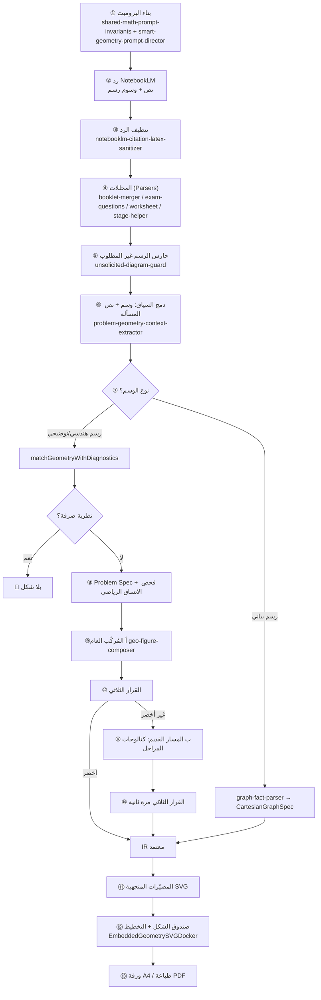

# التقرير التحليلي الكامل: منظومة الأشكال الهندسية والرسوم البيانية

> **تاريخ الفحص:** 6 نوفمبر 2026 — فحص حي للكود الحالي (آخر commit: `e893347`).
> **حالة الاختبارات وقت الفحص:** `68` ملف اختبار / `763` اختباراً — جميعها ناجحة (`npx vitest run` نُفّذ فعلياً).
> **ملاحظة:** حُذف التقرير القديم `geometry-and-charts-pipeline-audit-report.md` (قرار المالك D-3) ولا يُعتمد عليه. كما حُذفت هياكل `statistics-engine/*-branch.ts` الفارغة.
> **الخطة المرتبطة:** [`geometry-primary-prep-coverage-master-plan.md`](./geometry-primary-prep-coverage-master-plan.md)

---

## 1. الخلاصة التنفيذية

| السؤال | الجواب المختصر |
|---|---|
| ما فلسفة النظام؟ | **Zero-DSL**: NotebookLM يكتب *حقائق رياضية بالعربية* فقط، والمحرك الحتمي (TypeScript) يستنتج الشكل ويرسمه SVG متجهياً. |
| هل النظام «يفهم» كل مسألة؟ | جزئياً. يفهم عبر **ثلاثة مستويات**: (أ) مُركِّب عام قائم على الحقائق، (ب) مصنّف هيئات التشابه، (ج) كتالوجات ثابتة بالكلمات المفتاحية. المستوى (ج) هو نقطة الضعف. |
| هل يرسم شكلاً خاطئاً؟ | على المجموعة الذهبية الحالية (375 حالة): **صفر** شكل مرسوم لمسألة لا تستحق شكلاً. لكن **الدقة الحقيقية غير مُثبتة** لأن لا حالة راجعها إنسان بعد. |
| التغطية؟ | **73.3%** من الحالات أنتجت شكلاً، لكن **43.7% فقط** بلا أي علامة خطر آلية. |
| أكبر خطر؟ | اعتماد **109 شكلاً (≈40% مما أُنتج)** على كتالوجات ثابتة بكلمات مفتاحية (`from_fixed_catalog`). |
| أكبر فجوة منهجية؟ | الصفوف الابتدائية 1–3 غير ممثّلة في SSOT أصلاً، والصف الخامس والإحصاء/الدوال خارج المجموعة الذهبية تقريباً. |
| الـ PDF؟ | سليم معمارياً (SVG متجهي → صندوق → ورقة A4)، والمسار مشترك بين الامتحانات والمذكرات والمراجعات وأوراق العمل. |

---

## 2. خريطة خط الأنابيب الكامل (من البرومبت إلى الـ PDF)

---

## 3. تفصيل المراحل

### المرحلة ① — صياغة البرومبت
- **الملفات:** [`shared-math-prompt-invariants.ts`](../src/core/prompts/shared-math-prompt-invariants.ts)، [`smart-geometry-prompt-director.ts`](../src/core/prompts/smart-geometry-prompt-director.ts). تستدعيها جميع بُناة البرومبت (مذكرات، امتحانات رسمية/إلكترونية، مراجعات، أوراق عمل).
- **ما يُحقن:** سطر واحد (~350 حرفاً) يطلب `[رسم هندسي: ...]` بحقائق مفصولة بـ `;` (رؤوس، أطوال بوحدات، زوايا، توازي، تعامد) ويمنع الوسوم العائمة بلا رؤوس، ويذكر `[رسم بياني: ...]` للدوال.
- **متى يُحقن؟** `isGeometryContext`: فقط إذا كان الفرع `plane_geometry` أو `solid_geometry` أو `analytic_geometry`، أو إذا طابق عنوان الوحدة/الدرس قائمة كلمات هندسية.
- **ملاحظات نقدية:**
  1. لا يطلب **«المطلوب»** (ما الذي يُسأل عنه) بصيغة منظمة، مع أن المحرك يحتاجه لرسم «؟» (`geometry-asked-question-mark-resolver`).
  2. لا يفرّق بين **المعطى** و**المجهول** و**الاسم** في الصياغة.
  3. **لا يغطي الإحصاء ولا النماذج البصرية الابتدائية** (ساعة، نموذج الشريط، خط الأعداد)؛ فرع `statistics_probability` و`numbers` لا يُحقن لهما توجيه رسم.
  4. لا أمثلة (few-shot) رغم أنها أقوى وسيلة لضبط ردود النموذج؛ القيد هو مساحة السياق.

### المرحلة ②–③ — الرد والتنظيف
- يعتمد النظام على نمط ثابت: `[رسم (هندسي|توضيحي|بياني): ...]`.
- [`notebooklm-citation-latex-sanitizer.ts`](../src/core/ingestion/notebooklm-citation-latex-sanitizer.ts): ينزع الاقتباسات `【..】` ويصلح وسوماً مكسورة ويعالج هلوسة «أربعة أشعة» (`healFourRaysHallucination`).

### المرحلة ④ — المحللات (أي مستند يمر؟)
| نوع المخرَج | المحلل |
|---|---|
| مذكرات (3 مراحل) | `notebooklm-booklet-stages-merger` + `notebooklm-stage-parsers-helper` |
| امتحانات رسمية/إلكترونية | `notebooklm-exam-questions-parser` |
| نماذج الامتحان (A/B…) | `notebooklm-exam-forms-parser` → يمر على `exam-questions-parser` |
| المراجعات النهائية | `notebooklm-final-review-parser` → يمر على `exam-questions-parser` |
| أوراق العمل | `notebooklm-worksheet-parser` |

كلها تنتهي إلى **نفس الدالة** `matchGeometryWithDiagnostics` و`parseCartesianGraphDescription` ⇒ **وحدة المسار** نقطة قوة (إصلاح واحد يفيد الجميع).

### المرحلة ⑤ — حارس الرسم غير المطلوب
[`unsolicited-diagram-guard.ts`](../src/core/ingestion/unsolicited-diagram-guard.ts): لا رسم إلا إذا وُجد وسم + (إشارة بصرية صريحة في السؤال، أو فرع هندسي). يحجب الأسئلة الجبرية الخالصة. **يُطبَّق في محلل الامتحانات فقط** حسب نتائج البحث — يلزم التحقق من تطبيقه في المذكرات وأوراق العمل (انظر الفجوة G-9).

### المرحلة ⑥ — دمج السياق
[`problem-geometry-context-extractor.ts`](../src/core/geometry-engine/description-intake/problem-geometry-context-extractor.ts) و[`geometry-latex-to-plain-normalizer.ts`](../src/core/geometry-engine/description-intake/geometry-latex-to-plain-normalizer.ts) و[`geometry-clause-restructurer.ts`](../src/core/geometry-engine/description-intake/geometry-clause-restructurer.ts):
- يدمج الوسم مع نص المسألة (لأن الوسم كثيراً ما يكون ناقصاً).
- يستخرج علاقات التشابه/التطابق مع **ترتيب الرؤوس التناظري**.
- يحوّل LaTeX إلى نص مجرد (`\Delta→Δ`, `\parallel→//`, `\perp→⊥`).

### المرحلة ⑦–⑩ — قلب المحرك: `matchGeometryWithDiagnostics`
الملف: [`natural-arabic-geometry-matcher.ts`](../src/core/geometry-engine/natural-arabic-geometry-matcher.ts) (الترتيب الفعلي في الكود):

1. **نظرية صرفة؟** (`isPurelyTheoreticalNoDiagramProblem`) ⇒ 🔴 بلا شكل.
2. **Problem Spec مزدوج** (`extractGeometryProblemSpecDual`: Regex + مواصفة) ثم **فحص الاتساق الرياضي** (المتباينة المثلثية، مجموع الزوايا، فيثاغورس). فشل ⇒ 🔴 مع سبب.
3. **المُركِّب العام** `composeFigureFromGeometryDescription`:
   - إذا كان السياق **تشابه/تطابق/إقليدس/طاليس/ظل** ⇒ `buildParametricSimilarityFigure` (8 هيئات طوبولوجية).
   - وإلا يحلل الحقائق (`geo-fact-parser`): طول، زاوية، نقطة على ضلع، منتصف، توازي، تعامد، منصف، متوسط، تقاطع، قطرا متقاطعان، امتداد، تساوٍ، رسم قطعة.
   - يضع المضلعات (`geo-shape-placers` / `geo-triangle-placer`) ثم يحسب النقاط المشتقة بالمتجهات (`geo-vector-math`).
   - الدوائر عبر `geo-circle-composer-helper`، ومروحة الزوايا عبر `angle-fan-family`.
4. **قاعدة «؟» للمطلوب** (`applyAskedQuestionMarkToFigure`): يضع «؟» على المجهول المطلوب بدل قيمة الحل.
5. **التحسين العددي** (`refineFigureToMatchGivens`: Levenberg–Marquardt متعدد البدايات) لمطابقة الأطوال المكتوبة — **ما عدا 4 فروع «مقفلة طوبولوجياً»** (طاليس، الساعة الرملية، إقليدس، الشكل المركب) لأن التحريك يكسر استقامتها.
6. **القرار الثلاثي** [`geometry-tri-state-decision-gate.ts`](../src/core/geometry-engine/verification/geometry-tri-state-decision-gate.ts):
   - فحص 1: إعادة قياس الأطوال/الزوايا من الشكل المرسوم.
   - فحص 2: **اكتمال** كل رقم هندسي في النص على الشكل.
   - فحص 3: **لا زيادات ولا تسريب حل** (أرقام/رؤوس غريبة، قيم محسوبة).
   - 🟢 أخضر ⇐ الثلاثة ناجحة وبلا تحذيرات المُركِّب. 🟡 أصفر ⇐ نقص قابل للإصلاح (سطر غير مفهوم / نقاط غير معرّفة). 🔴 أحمر ⇐ نظري أو تسريب أو فشل قياس.
7. **عند عدم الأخضر من المُركِّب** ⇒ المسار القديم `matchOptionalGeometryFigureFromArabicDescription`:
   - إن كان السياق تشابهاً ⇒ المصنّف البارامتري مع بوابة صدق.
   - وإلا سلسلة **~25 دالة كتالوج** مرتبة بـ `??` (ابتدائي 4 بصري ← إعدادي 3 ← 2 ← 1 ← ابتدائي 6/5/4)؛ **الأول المطابق يفوز**.
   - ثم فروع عائلية بكلمات مفتاحية: دالة تربيعية/خط أعداد/مستوى إحداثي، مثلث (إقليدس/متوسط/طاليس/منصف/خارجة/منتصف)، دائرة (مماسان/محيطية/رباعي دائري/…)، رباعيات، **مجسمات** (هرم/مخروط/مكعب/مستوى مائل).
   - النتيجة تمر على القرار الثلاثي مرة ثانية؛ غير الأخضر ⇒ **لا شكل** مع الأسباب.

### المرحلة ⑪ — الرسم المتجهي
| المصيّر | الملف |
|---|---|
| أشكال هندسية | `vector-svg-figure-projector.ts` (+ `…angle-projector`, `…circles-and-arcs-projector`, `…surface-shading-projector`) |
| رسوم بيانية | `graph-compositor/graph-svg-projector.ts` |
| إحصاء (صف 6) | `statistics-engine/primary-grade6-{bar-chart,box-plot,dot-plot,histogram}-svg-builder.ts` |
| نماذج بصرية | `primary-grade4-analog-clock-svg-builder`, `primary-grade4-bar-model-svg-builder`, `area-model-arithmetic-svg-builder` |
| المنسّق | [`question-figure-svg-renderer.ts`](../src/core/pdf-layout-engine/question-figure-svg-renderer.ts): أولوية `rawSvgMarkup` ثم الشكل ثم الرسم البياني |

التعريب (`figure-label-symbol-localizer` + `numeral-and-unit-ssot`) يحوّل الرؤوس A,B,C↔أ,ب,جـ والأرقام 0-9↔٠-٩ عند الرسم، وليس عند الاستخراج (جيد: IR محايد).

### المرحلة ⑫–⑬ — من الـ SVG إلى الورقة
`EmbeddedGeometrySVGDocker` يحسب نسبة الأبعاد من الرؤوس (`question-figure-box-size`) ويحقن SVG داخل بطاقة السؤال؛ ثم محركات التخطيط (`flow-page-geometry-box-layout`, `side-by-side-diagram-docker`, `two-column-newspaper-packer`) والطباعة المعزولة (`pdf-isolated-print-trigger`). المتجه يبقى متجهاً عند الطباعة (210×297 مم، خلفية بيضاء، خط ≥ 12pt لمتن الأسئلة).
نفس الدالة تُستخدم في بطاقة الاختبار الإلكتروني للطالب (`exam-question-card.tsx`) ومعاينة الاستوديو.

---

## 4. ما الموجود فعلاً (مرصود من الكود)

| العائلة | المحتوى | الملاحظة |
|---|---|---|
| مُركِّب الحقائق | 9 ملفات في `fact-compositor/` | الأساس العام القابل للتوسع |
| التشابه والتطابق | 8 هيئات في `similarity-family/` | الأنضج؛ مقفل طوبولوجياً |
| مروحة الزوايا | `angle-fan-family/` (5 ملفات) | أول إعدادي |
| مثلثات / دوائر / رباعيات | 6 + 7 + 5 ملفات فروع | أشكال «مولّبة» بكلمات مفتاحية |
| دوال/إحداثيات | `analytic-function-family/` + `graph-compositor/` | خطي، تربيعي، مقياس، أفقي، رأسي، نقاط، مضلع على الشبكة |
| ابتدائي | كتالوجات صف 4 (9 ملفات)، صف 5 (1)، صف 6 (7) | صف 4: زوايا، تصنيف مثلثات، محيط/مساحة، مركبة متعامدة، أبعاد مجهولة، ساعة، نموذج شريط |
| إحصاء | صف 6: نقاط/صندوق/مدرج/أعمدة | عبر كتالوج الهندسة للصف 6 |
| إعدادي | صف 1 (30 ملف)، صف 2 (30)، صف 3 (15) | ≈ 77 ملف كتالوج، 689KB كود |
| التحقق | 13 ملفاً في `verification/` | أقوى طبقة في النظام |
| القياس | `baseline-measurement/` + `tests/golden-corpus/geometry/*.json` | 375 حالة |

---

## 5. قياس الأداء الحالي (من `docs/qa/geometry-baseline-report.md`)

| الصف | الحالات | شكل بلا علامات | شكل بعلامات خطر | شكل مفقود | رفض صحيح |
|---|---|---|---|---|---|
| أول إعدادي | 120 | 35 | 60 | 19 | 6 |
| ثاني إعدادي | 89 | 14 | 43 | **32** | 0 |
| ثالث إعدادي | 33 | 15 | 7 | 9 | 2 |
| رابع ابتدائي | 49 | 21 | 0 | 0 | 28 |
| سادس ابتدائي | 29 | 25 | 0 | 0 | 4 |
| غير مصنّف | 55 | 54 | 1 | 0 | 0 |
| **المجموع** | **375** | **164** (43.7%) | **111** (29.6%) | **60** | **40** |

- علامة `from_fixed_catalog`: **109** — كلها ⇒ شكل قادم من قالب ثابت وليس من فهم المسألة.
- علامة `missing_given_on_figure`: **8** (معطيات لم تظهر على الشكل).
- **لا توجد حالات للصف الخامس ولا الأول–الثالث الابتدائي، ولا للدوال/الإحداثيات/المجسمات/الدوائر المتقدمة** ⇒ لا قياس لها أصلاً.
- ⚠ «بلا علامات خطر» ≠ «صحيح». الدقة الحقيقية تساوي **غير معروفة** حتى تُملأ خانة `humanVerdict`.

---

## 6. الفجوات الحقيقية (مرتبة حسب الخطورة)

| # | الفجوة | الأثر | الدليل |
|---|---|---|---|
| **G-1** | الاعتماد على كتالوجات ثابتة بالكلمات المفتاحية، وترتيب `??` الحرج | أشكال قد تطابق «الكلمة» لا «المسألة»؛ خطر خطف المسائل عند إضافة كتالوج | matcher الأسطر 108–133؛ 109 حالة بعلامة الخطر |
| **G-2** | الدقة غير مُثبتة بشرياً | لا يمكن ادعاء ≥ 99% | `humanVerdict` فارغ |
| **G-3** | تغطية ضعيفة في ثاني إعدادي (32 مفقوداً من 89) وأول إعدادي (19) | أسئلة تستحق شكلاً بلا شكل | جدول القسم 5 |
| **G-4** | الصفوف الابتدائية 1–3 غير موجودة في `EGYPTIAN_MATH_GRADES_SSOT` (تبدأ من `prim-3`، ولا `prim-1/2`) | لا توليد/مناهج لأكثر من نصف المرحلة | `curriculum-hierarchy-ssot.ts` الأسطر 50–60 |
| **G-5** | البرومبت لا يطلب «المطلوب» ولا يغطي الإحصاء والنماذج البصرية | المحرك يعمل بدون أهم مدخل لقاعدة «؟» | `smart-geometry-prompt-director.ts` |
| **G-6** | الدوال: خطي/تربيعي/مقياس/أفقي/رأسي فقط | لا تكعيبي/كسري/أسّي/جذري/مثلثي/متباينات/تقاطع | `graph-fact-parser.ts` الأسطر 17–55 |
| **G-7** | الإحصاء: الصف 6 فقط (4 أنواع)؛ ملفات `statistics-engine/*-branch.ts` الخمسة (19 سطراً) **هياكل فارغة** تنتج `DatasetIR` بلا بيانات ولا رسم | جداول تكرارية، مضلع، منحنى، قطاعات دائرية (مطلوبة في الإعدادي) غائبة | `histogram-bar-chart-branch.ts` وأخواته |
| **G-8** | لا حلقة مراجعة للمعلم: الأصفر/الأحمر يظهران كلافتة تحذير فقط (`studio-figure-diagnostics-banner`)، دون تحرير قائمة الحقائق وإعادة الفحص | يضيع الأصفر القابل للإصلاح | المرحلة 5 من الخطة السابقة لم تُنفَّذ |
| **G-9** | تباين تطبيق `isDiagramJustifiedForQuestion` بين المحللات | خطر رسم غير مطلوب في المذكرات/أوراق العمل | grep: مستدعى في `exam-questions-parser` فقط |
| **G-10** | المجسمات ثابتة القوالب: الأبعاد غير الواردة تُستبدل بقيم افتراضية داخل البناة؛ لا مساقط ولا أبعاد جانبية معنونة | شكل لا يعكس السؤال؛ لا يمرّ غالباً على فحص الاكتمال (`solid3d_mechanics_family` يُعفى من التحسين) | matcher الأسطر 165–191 + `finalizeVerifiedFigure` |
| **G-11** | تكرار منطق كشف «التشابه» (Regex ضخم) في الـ matcher والـ composer | مخالفة قانون عدم التكرار؛ احتمال انحراف السلوك | matcher 84–92 مقابل composer 36–43 |
| **G-12** | كلمات حجب شاملة (`شجرة|مبنى|…|ظل`) تُعيد `undefined` قبل بعض البناة | حالات مسائل حياتية تُحجب بدل أن تُرسم | matcher السطر 142 |
| **G-13** | طباعة: لا قواعد صريحة لتصادم الملصقات، ولا نمط أبيض/أسود (تظليل بالتهشير بدل اللون)، ولا حد أدنى لحجم خط ملصقات SVG | شكل جيد على الشاشة وأقل وضوحاً مطبوعاً | لم يظهر في ملفات المصيّر المفحوصة؛ يحتاج تدقيقاً |
| **G-14** | المجموعة الذهبية بلا مفتاح «شكل صحيح متوقع» بصيغة قابلة للمقارنة الآلية (IR مرجعي) | المراجعة يدوية بالكامل | `golden-corpus-case-types-ssot.ts` |

> **تصحيح للتقرير القديم:** (1) المحسّن العددي **مُفعَّل ومستخدم** الآن (`finalizeVerifiedFigure`)، وليس مهملاً. (2) الإحصاء للصف 6 **موصول** عبر الكتالوج. (3) الدوال التكعيبية… ما زالت غائبة (يبقى صحيحاً).

---

## 7. نقاط القوة (يجب الحفاظ عليها)

1. **سياسة Zero-DSL** — لا يعتمد النظام على قدرة النموذج في الرسم.
2. **بوابة الصدق + الاكتمال + عدم التسريب + إعادة القياس** — النتيجة: صفر شكل مرسوم لمسألة لا تستحق.
3. **القرار الثلاثي** مع أسباب مقروءة.
4. **IR محايد عن العرض** + تعريب عند الرسم فقط.
5. **المسار الموحد** لكل أنواع المستندات والـ PDF والامتحان الإلكتروني.
6. **القياس الآلي** (Baseline runner + Golden corpus) بدل التخمين.

---

## 8. الوثائق السابقة
- التقرير القديم والهياكل الفارغة **حُذفت** (قرار المالك، بعد grep شامل و	sc و763 اختباراً ناجحاً).
- geometry-figure-fidelity-master-plan.md وparametric-geometry-synthesis-master-plan.md: مراحلهما 0–4 منفذة، والمتبقي مدمج في الخطة الجديدة.

