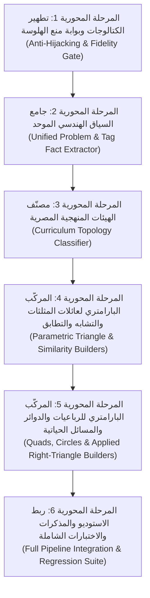

# الخطة الهندسية الشاملة لمحرك التوليد البارامتري الذكي للأشكال الهندسية
## (`Parametric Curriculum Geometry Synthesis Engine — Master Execution Plan`)

> **الهدف الحاكم:** تحويل محرك الهندسة في المنصة من «مطابقة قوالب ثابتة صمّاء» إلى **«محرك استنباط وبناء بارامتري ذكي للمناهج المصرية»** يستخلص المعطيات من وسم الرسم ونص المسألة معاً، ويحدد الهيئة الهندسية (Topology)، وينشئ شكلاً مطابقاً ١٠٠٪ لرؤوس وأرقام ومجاهيل وزوايا السؤال، مع حظر قاطع لظهور أي شكل يحتوي على أرقام أو رؤوس غريبة عن المسألة.

---

## المبادئ المعمارية الحاكمة (Architectural Invariants)

1. **عدم التضارب بين المراحل (`Zero Cross-Phase Conflict`):**
   - كل مرحلة تُبنى في ملفات ذرية مستقلة بأسماء فريدة عالمياً (`< 300` سطر للملف وفق `AGENTS.md`)، ولا تكسر أي اختبار قائم في `Vitest` (الـ `591` اختباراً الحالية تظل خضراء بعد كل مهمة فرعية).
2. **فصل الهيكل البصري عن البطاقات المكتوبة (`Topology vs. Annotation Separation`):**
   - **الهيكل البصري (الإحداثيات):** يُحسب هندسياً من الأطوال الرقمية أو من نسب التشابه، وعند وجود مجاهيل جبرية ($x + 2$) يُحل المجهول ضمنياً أو تُفرض أبعاد متناسقة بصرياً.
   - **البطاقات المكتوبة (Labels):** لا يُكتب على الأضلاع والزوايا إلا القيم والرموز الواردة فعلياً في نص المسألة (مثل `x + 2 سم`، `40°`، `6 سم`).
3. **الاستنباط المزدوج (`Tag + Problem Prompt Fusion`):**
   - إذا كان وسم `[رسم هندسي: ...]` مختصراً أو ناقصاً أو غائباً في مسألة هندسية، يستكمل المحرك الرؤوس والأطوال والزوايا من نص المسألة الأصلي تلقائياً.
4. **بوابة الصدق البصري الصارمة (`Zero-Hallucination Fidelity Gate`):**
   - يُمنع منعاً باتاً إرفاق أي شكل يحتوي على رأس أو رقم أو زاوية غير مذكورة في المسألة. إذا كانت المسألة نظرية بحتة بلا معطيات رسم، لا يُرفق لها شكل.

---

## خريطة المراحل المحورية الست (6 Pivotal Non-Conflicting Phases)

---

## المرحلة المحورية الأولى: تطهير الكتالوجات وبوابة منع خطف المسائل (`Phase 1: Anti-Hijacking & Strict Fidelity Gate`)

**الهدف:** إيقاف الأخطاء الفورية الناتجة عن خطف المسائل بكلمات عامة (مثل كلمة «متطابقا الزوايا» التي تحول المسألة لكتالوج ٢ إعدادي) وإلغاء جميع قوالب الـ Fallback العمياء ذات الأرقام الثابتة (`8, 12, 18` أو `2y`).

### المهمات الفرعية الدقيقة (Sub-tasks):

- [x] **المهمة 1.1 — إنشاء بوابة الصدق البصري (`src/core/geometry-engine/verification/geometry-figure-fidelity-gate.ts`):**
  - فحص رؤوس الشكل المولد مقابل الرؤوس المذكورة في نص المسألة + وسم الرسم؛ رفض أي شكل يحتوي على رؤوس دخيلة.
  - فحص بطاقات الأطوال والزوايا (`lengthLabel`, `degreesLabel`)؛ رفض أو تجريد أي رقم/مجهول غير موجود في نص المسألة.
  - حجب الرسم تلقائياً في الأسئلة النظرية الصرفة التي لا تحتوي على رؤوس ولا أطوال ولا زوايا محددة.

- [x] **المهمة 1.2 — فك التصادم بين «التطابق» و«التشابه» في (`src/core/geometry-engine/natural-arabic-geometry-matcher.ts`):**
  - تعديل شرط التطابق بالسطر `67` بحيث يُستبعد فوراً إذا احتوى النص على رمز التشابه `~` أو `\sim` أو كلمة `تشابه / متشابهان / متشابهين / متطابقا الزوايا / زوايا متطابقة`.
  - تقديم الكومبوزر البارامتري على الكتالوجات الثابتة، وعدم قبول نتيجة الكتالوج الثابت إلا بعد اجتياز `geometry-figure-fidelity-gate`.

- [x] **المهمة 1.3 — إزالة قوالب الـ Fallback العمياء من كتالوجات الإعدادي:**
  - إزالة الشرط العام في `prep-grade2-triangle-congruence-catalog.ts` (السطر `151`) الذي يعيد شكل الانعكاس ذي الزاوية `(2y)°` لأي مسألة فيها كلمة «تطابق».
  - إزالة الشرطين العامين في `prep-grade3-triangle-similarity-catalog.ts` (السطرين `75` و `80`) اللذين يعيدان شكل الفراشة الثابت (`8, 12, 18`) أو شكل الـ `120°` الثابت لأي مسألة فيها `ABC ~ DEF` أو `مثلثان متشابهان`.

---

## المرحلة المحورية الثانية: جامع السياق الهندسي الموحد (`Phase 2: Unified Problem & Tag Context Extractor`)

**الهدف:** جعل النظام يقرأ **وسم `[رسم هندسي: ...]` + نص المسألة (`promptAr`) معاً** ليستخرج كل حقيقة هندسية حتى لو كان وسم الرسم مختصراً أو غائباً.

### المهمات الفرعية الدقيقة (Sub-tasks):

- [x] **المهمة 2.1 — بناء جامع السياق الموحد (`src/core/geometry-engine/description-intake/problem-geometry-context-extractor.ts`):**
  - دمج وسم `[رسم هندسي: ...]` مع نص المسألة الكامل في سلسلة حقائق موحدة خالية من التكرار.
  - استخراج علاقات التشابه والتطابق الصريحة: `ΔABC ~ ΔDEF`، `ΔADE ~ ΔACB`، `ΔABC ≅ ΔDEF` مع حفظ **الترتيب التناظري للرؤوس** (لأن ترتيب الرؤوس يحدد أي زاوية تساوي أي زاوية وأي ضلع يناظر أي ضلع).

- [x] **المهمة 2.2 — دعم الأطوال الترتيبية والجبرية والنسب في (`src/core/geometry-engine/fact-compositor/geo-fact-parser.ts`):**
  - تحليل الجمل الترتيبية الشائعة في المنهج المصري:
    - *"أطوال أضلاع $\Delta ABC$ هي $3\text{ سم}، 4\text{ سم}، 5\text{ سم}$"* $\leftarrow$ تحويلها تلقائياً إلى: `AB = 3`، `BC = 4`، `AC = 5`.
    - *"أطوال أضلاع المثلث الأول $x, x+2, x+4$"* $\leftarrow$ ربطها بأضلاع المثلث الأول بالترتيب.
  - تحليل الأطوال الجبرية بدلالة $x$ أو $س$: مثل `BC = x + 2 سم`، `EF = 2x - 1 سم`، `AB = x^2 - 1 سم` مع حفظ النص الجبري في `text` وحساب قيمة تقريبية موجبة للرسم في `numeric`.
  - تحليل النسب الصريحة: `AD : DB = 2 : 3` أو `AB = (1/3) DE` لاستخدامها في تحديد مواقع النقاط على الأضلاع دون إظهارها كأطوال سنتيمترية ما لم يذكر السؤال وحدة `سم`.

- [x] **المهمة 2.3 — تمرير السياق الموحد في محللات المذكرات والامتحانات:**
  - تحديث `notebooklm-booklet-stages-merger.ts` و `notebooklm-stage-parsers-helper.ts` و `notebooklm-exam-questions-parser.ts` لتمرير `(ex.geometryRaw, ex.promptAr)` إلى جامع السياق الموحد.

---

## المرحلة المحورية الثالثة: مصنّف الهيئات المنهجية المصرية (`Phase 3: Curriculum Topology Classifier`)

**الهدف:** تحديد الهيئة الهندسية الدقيقة للمسألة حتمياً من **تقاطع مجموعات الرؤوس والعلاقات الهندسية** دون الاعتماد على تخمين الكلمات.

### المهمات الفرعية الدقيقة (Sub-tasks):

- [x] **المهمة 3.1 — بناء مصنّف الهيئات (`src/core/geometry-engine/similarity-family/curriculum-topology-classifier.ts`):**
  يصنّف أي مسألة مثلثات/تشابه/تطابق حتمياً إلى إحدى الهيئات القياسية الثماني:
  1. **`disjoint_two_triangles`**: مثلثان لا يشتركان في أي رأس ($\{A,B,C\} \cap \{D,E,F\} = \emptyset$ أو $\Delta ABC \sim \Delta XYZ$).
  2. **`thales_parallel_in_triangle`**: مثلث $ABC$ ونقطتان على ضلعيه ($D \in AB, E \in AC$ أو $X \in AB, Y \in AC$) مع توازي $\overline{DE} \parallel \overline{BC}$ أو تشابه بنفس الترتيب $\Delta ADE \sim \Delta ABC$.
  3. **`antiparallel_in_triangle`**: مثلث $ABC$ ونقطتان $D \in AB, E \in AC$ مع تشابه معكوس الترتيب $\Delta ADE \sim \Delta ACB$ أو $m(\angle AED) = m(\angle B)$ أو $m(\angle ADE) = m(\angle C)$.
  4. **`hourglass_intersecting_chords`**: تقاطع قطعتين $\overline{AC} \cap \overline{BD} = \{E\}$ أو $\{M\}$ أو $\{O\}$ (سواء مع توازي $\overline{AB} \parallel \overline{CD}$ أو بتناسب الأضلاع الحاوية للزاوية المتقابلة بالرأس $\Delta ABE \sim \Delta CDE$).
  5. **`shared_vertex_secant_triangle`**: مثلثان يشتركان في رأسين والرابع على الضلع (مثل $\Delta ABC \sim \Delta DBA$ حيث $D \in \overline{BC}$، أو $\Delta ABC \sim \Delta DAC$).
  6. **`adjacent_ray_bisector_triangles`**: مثلثان يشتركان في رأس وضلع واحد (مثل $\Delta ABC \sim \Delta EBD$ حيث $\vec{BC}$ ينصف $\angle ABE$).
  7. **`euclid_right_triangle_altitude`**: مثلث قائم في رأس ($A$ أو $B$ أو $C$) مع عمود ساقط من رأس القائمة على الوتر ($\overline{AD} \perp \overline{BC}$ أو $\overline{BD} \perp \overline{AC}$ أو $\overline{CD} \perp \overline{AB}$).
  8. **`applied_shadow_height_triangles`**: مسائل الظل والارتفاع (عمود إنارة، شجرة، سارية علم، رجل وظله).

---

## المرحلة المحورية الرابعة: المركّب البارامتري لعائلات المثلثات والتشابه والتطابق (`Phase 4: Parametric Triangle & Similarity Builders`)

**الهدف:** بناء الدوال البارامترية الذرية التي ترسم كل هيئة من الهيئات الثماني **برؤوس وأطوال وزوايا المسألة الحقيقية فقط**.

### المهمات الفرعية الدقيقة (Sub-tasks):

- [ ] **المهمة 4.1 — مركّب المثلثين المنفصلين المتشابهين/المتطابقين (`src/core/geometry-engine/similarity-family/disjoint-triangles-parametric-builder.ts`):**
  - يرسم المثلث الأول (مثلاً $ABC$) والمثلث الثاني (مثلاً $DEF$ أو $XYZ$ أو $LMN$) متجاورين بتناسب بصري واضح (معامل تكبير/تصغير مستنتج من النسبة المعطاة أو $1 : 0.75$).
  - يضع الزوايا المعطاة فقط (مثلاً $40^\circ, 65^\circ$ في المثال 1-1، أو علامة الزاوية القائمة في $A$ في المثال 8-1، أو $120^\circ$ في المثال 9-1).
  - يضع الأطوال المعطاة فقط (سواء رقمية مثل `6 سم، 8 سم، 10 سم` أو جبرية مثل `x + 2 سم، 2x - 1 سم`).

- [ ] **المهمة 4.2 — مركّب المثلث المتداخل لطاليس والقاطع العكسي (`src/core/geometry-engine/similarity-family/nested-thales-antiparallel-builder.ts`):**
  - يرسم $\Delta ABC$ ويحدد موقع $D \in AB$ و $E \in AC$ بدقة بناءً على نسبة $AD : DB$ و $AE : EC$.
  - في حالة التوازي ($\overline{DE} \parallel \overline{BC}$): يضع سهمَي التوازي على $DE$ و $BC$.
  - في حالة القاطع العكسي ($m(\angle AED) = m(\angle B)$): يميل القاطع $DE$ ويضع قوسَي تساوي الزاويتين عند $E$ و $B$، ويضع الأطوال المعطاة ($AD, DB, AE, EC, DE, BC$) في أماكنها الصحيحة دون تداخل.

- [ ] **المهمة 4.3 — مركّب الساعة الرملية وتقاطع القطرين (`src/core/geometry-engine/similarity-family/hourglass-intersection-parametric-builder.ts`):**
  - يتعرف على نقطة التقاطع ($E$ أو $M$ أو $O$) والقطعتين المتقاطعتين ($AC \cap BD$ أو $AB \cap CD$).
  - يرسم المثلثين المتقابلين بالرأس (مثل $\Delta ABE$ و $\Delta CDE$ أو $\Delta AEC$ و $\Delta DEB$) بنسبة أطوال حقيقية.
  - يضع أسهم التوازي فقط إذا ذكر السؤال $\overline{AB} \parallel \overline{CD}$، أو قوسَي تساوي الزاويتين إذا ذكر $m(\angle A) = m(\angle D)$، ويكتب الأطوال المعطاة ($AB, CD, AE, EC, BE, ED$).

- [ ] **المهمة 4.4 — مركّب المثلث المشترك في زاوية والمجاور بمنصف (`src/core/geometry-engine/similarity-family/shared-angle-and-bisector-builder.ts`):**
  - لحالة $\Delta ABC \sim \Delta DBA$ أو $\Delta DAC$: يرسم $\Delta ABC$ ويصل القاطع الداخلي $AD$ إلى النقطة $D \in BC$ ويضع الأطوال الفعلية للمسألة (مثل $18, 9, 36, 12$ في المثال 9-2، أو $12, 6, 24, 8$ في تمرين 9-2، أو $8, 12, 18, 27$ في المثال 13-2).
  - لحالة $\Delta ABC \sim \Delta EBD$ مع تنصيف $\vec{BC}$ لزاوية $\angle ABE$: يرسم المثلثين متجاورين حول الضلع المشترك $BC$ مع علامتي تنصيف الزاوية عند $B$ والأطوال الفعلية.

- [ ] **المهمة 4.5 — مركّب إقليدس البارامتري بجميع أوضاعه (`src/core/geometry-engine/similarity-family/euclid-altitude-parametric-builder.ts`):**
  - يدعم كون الزاوية القائمة في **$A$** ($\overline{AD} \perp \overline{BC}$) أو في **$B$** ($\overline{BD} \perp \overline{AC}$) أو في **$C$** ($\overline{CD} \perp \overline{AB}$).
  - يضع مربع الزاوية القائمة في رأس المثلث وعند مسقط العمود على الوتر.
  - يكتب **فقط** الأطوال المذكورة في المسألة (مثل $BD = 9, CD = 16$ أو $AD = 3.6, BD = 6.4$ أو $BD = 2, CD = 8$) دون إضافة أي رقم غير معطى.

---

## المرحلة المحورية الخامسة: المركّب البارامتري للرباعيات والدوائر والمسائل التطبيقية (`Phase 5: Quads, Circles & Applied Shadow Builders`)

**الهدف:** تغطية المسائل الحياتية (الظل والارتفاع) والمضلعات الرباعية المتشابهة في نفس المحرك البارامتري.

### المهمات الفرعية الدقيقة (Sub-tasks):

- [ ] **المهمة 5.1 — مركّب مسائل الظل والارتفاع الحياتية (`src/core/geometry-engine/similarity-family/applied-shadow-height-builder.ts`):**
  - يحول مسائل (عمود إنارة + رجل وظله، شجرة + شخص وظله، سارية علم + طالب وظله) إلى رسم هندسي واضح لمثلثين قائمين متشابهين ($\Delta CAB$ للعمود/الشجرة و $\Delta CDE$ للرجل/الطالب وظله) مع كتابة الارتفاعات والمسافات المعطاة بالمتر (`1.8 م`، `2.4 م`، `2 م`).

- [ ] **المهمة 5.2 — تحسين مركّب الرباعيات والمستطيلات البارامتري (`src/core/geometry-engine/fact-compositor/geo-shape-placers.ts`):**
  - دعم رسم مضلعين رباعيين متشابهين ($ABCD \sim EFGH$) بأطوال وزوايا المسألة الفعلية، ومنع رسم مستطيل بأرقام افتراضية (`8 سم، 5 سم`) إذا كانت المسألة تطلب أبعاداً بدلالة $x$.

---

## المرحلة المحورية السادسة: التكامل الشامل واختبارات المطابقة على المنهج (`Phase 6: Pipeline Integration & Full Regression Suite`)

**الهدف:** ربط المحرك الجديد بكامل المنصة واختباره آلياً على جميع مسائل مذكرة «تشابه المثلثات» (١٤ فكرة = ٢٨ مثالاً + ٥٦ تمريناً + ٥٦ واجباً) إلى جانب الاختبارات السابقة.

### المهمات الفرعية الدقيقة (Sub-tasks):

- [ ] **المهمة 6.1 — ربط مصنّف الهيئات والمركّبات البارامترية داخل (`src/core/geometry-engine/fact-compositor/geo-figure-composer.ts`):**
  - استدعاء `curriculum-topology-classifier` كمسار أول داخل الكومبوزر عندما تحتوي المسألة على تشابه أو تطابق أو إقليدس أو طاليس أو تقاطع وترين أو ظل وارتفاع.

- [ ] **المهمة 6.2 — تحديث الموجه الذكي للبرومبت (`src/core/prompts/smart-geometry-prompt-director.ts`):**
  - إضافة تنبيه صريح في الموجه الذكي يمنع NotebookLM من كتابة وسم رسم عائم بلا رؤوس (مثل `[رسم هندسي: مثلثان متداخلان]`)، ويلزمه بكتابة الرؤوس والأطوال المعطاة في السؤال أو عدم كتابة الوسم في الأسئلة النظرية.

- [ ] **المهمة 6.3 — كتابة جناح اختبارات شامل لرد نوت بوك الحقيقي (`tests/prep-grade3-similarity-full-notebooklm-response.test.ts`):**
  - اختبار جميع الأفكار الـ ١٤ من رد NotebookLM الذي أرفقته (الأمثلة + تمارين حاول بنفسك + الواجب المنزلي):
    1. التأكد من أن المثال 1-1 يرسم مثلثين منفصلين $ABC$ و $DEF$ بزاويتين $40^\circ$ و $65^\circ$ (وليس طائرة ورقية بـ `2y`!).
    2. التأكد من أن المثال 1-2 يرسم المثلثين $ABC$ و $DEF$ معاً بأطوال $6, 8, 10$ و $3$.
    3. التأكد من أن المثال 2-1 يرسم المثلثين $ABC$ و $XYZ$ بأطوال $3, 4, 5$ (وليس شكل مقص بـ `8, 12, 18`!).
    4. التأكد من أن المثال 3-1 يرسم $\Delta ABC$ وبداخله القاطع العكسي $DE$ بالأطوال $4, 5, 3, 6$ (وليس شبه منحرف!).
    5. التأكد من أن المثال 5-1 والمثال 5-2 يرسمان تقاطع الساعة الرملية عند $E$ و $M$ بالأطوال المعطاة.
    6. التأكد من أن جميع مسائل إقليدس (الفكرتان 11 و 12) ترسم المثلث القائم في الرأس الصحيح ($A$ أو $C$) بالأطوال المعطاة فقط.
    7. التأكد من أن مسائل الظل والارتفاع (الفكرة 14) ترسم نموذج المثلثين القائمين للعمود/الشجرة والظل بأطوال المسألة.
    8. التأكد من أن **صفر شكل** في المذكرة كلها يحتوي على أي رقم أو رأس غير مذكور في سؤاله.
    9. تشغيل `npx tsc --noEmit` و `npx vitest run` والتأكد من نجاح ١٠٠٪ من الاختبارات.
