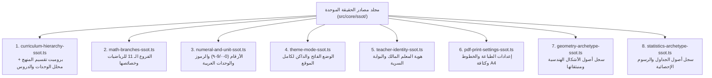

# الخطة النهائية الشاملة لبناء منصة الرياضيات المستقلة المتخصصة
## (Math-First Atomic Architecture, Single-Owner & Stealth Auth, High-Density A4 Print Engine & Parametric Geometry Registry)

> [!IMPORTANT]
> **الهدف الاستراتيجي لهذه الوثيقة:**
> بناء منصة مستقلة فائقة الرشاقة والدقة مخصصة **حصرياً لمادة الرياضيات بفروعها الأحد عشر**، ومصممة لـ **معلم واحد مالك فقط + طلابه**، مع استيعاب كامل للتوسعات المستقبلية (**محاضرات الفيديو المحمية، الواجبات المنزلية التفاعلية، المذكرات الدراسية، المراجعات النهائية، والاختبارات الإلكترونية الحية**)، وتطبيق **قانون الذرية المطلقة للملفات (`One Micro-Feature = One Uniquely Named File`)** لمنع تضخم الكود أو تداخله نهائياً.

---

## القسم الأول: اختيار اللغة والتقنية الأفضل للذكاء الاصطناعي جيميناي (Tech Stack Selection)

لتحقيق أعلى دقة برمجية بحيث يكتب الذكاء الاصطناعي (Gemini) الكود بالكامل ويختبره ذاتياً دون أي تدخل بشري ودون أخطاء:
1. **اللغة البرمجية المعتمدة: `TypeScript 5.8+` بالوضع الصارم الأقصى (`strict: true`, `noImplicitAny: true`)**
   - **لماذا هي الأفضل لـ Gemini؟** لأن مترجم TypeScript (`tsc --noEmit`) يعمل كـ **مدقق برهان رياضي للكود**؛ إذا أخطأ النموذج في اسم خاصية أو عقد بيانات في أي ملف، يكشفه المترجم في ثانيتين برقم السطر الدقيق قبل تشغيل المتصفح.
2. **إطار العمل والواجهة: `Next.js 15 (App Router)` + `React 19` + `Tailwind CSS v4`**
   - يضمن كتابة التنسيقات داخل نفس المكون الذري الصغير دون ملفات CSS خارجية متشابكة.
3. **محرك الرياضيات والرسوم المتجهية: `KaTeX` (مع عازل `BiDi`) + `Pure Deterministic SVG`**
   - معادلات رياضية فورية ورسوم هندسية وإحصائية متجهية (`Vector SVG`) بدقة مطبعية لا تبكسل أبداً عند الطباعة أو التكبير.
4. **بوابة التحقق الذاتي: `Vitest`**
   - تشغيل اختبارات الوحدة في أقل من ثانية واحدة بعد كل مهمة فرعية.

---

## القسم الثاني: الهوية المعمارية للمنصة ونظام الدخول الموحد (Single-Owner & Stealth Auth)

### 1. معلم مالك واحد + طلاب فقط (Zero Multi-Tenant Complexity)
- لا يوجد نظام تعدد معلمين ولا صلاحيات معقدة تستهلك آلاف الأسطر؛ المنصة ملك **لمعلم الرياضيات وحده**، والمستخدمون الآخرون هم **الطلاب** الذين يشاهدون الفيديوهات، ويحملون المذكرات، ويحلون الواجبات، ويؤدون الاختبارات الإلكترونية.

### 2. صفحة تسجيل دخول واحدة فقط ببوابة خفية للمعلم (`Unified Login with Stealth Teacher Access`)
بدلاً من تقسيم الموقع إلى صفحتي دخول، توجد **صفحة دخول واحدة فقط (`src/app/page.tsx` $\leftarrow$ `unified-portal-login-view.tsx`)** تتكون من ملفين ذريين:
1. **`student-code-login-form.tsx` (الواجهة الظاهرة للطلاب):**
   - حقل أنيق وبسيط يدخل فيه الطالب **كود الطالب أو رقم هاتفه** ليدخل مباشرة إلى بوابته التعليمية (الفيديوهات، المذكرات، الواجبات، الاختبارات).
2. **`stealth-teacher-unlock-trigger.tsx` (البوابة السرية للمعلم المالك):**
   - لا يظهر أي زر مكتوب عليه "دخول المعلم" أمام الطلاب إطلاقاً.
   - يدخل المعلم المالك بطريقتين سريتين من نفس الشاشة:
     * **الطريقة الأولى:** النقر 5 مرات متتالية على الشعار الرياضي $(\sum)$ في أعلى البطاقة.
     * **الطريقة الثانية:** كتابة الكود السري الخاص بالمعلم (`#MATH-MASTER#`) داخل حقل كود الطالب نفسه.
   - فور التفعيل، تنبثق خانة **مفتاح المالك السري (`Master Passkey`)** لتنقله مباشرة إلى استوديو المعلم المالك!

---

## القسم الثالث: قانون الذرية المطلقة للملفات ومصادر الحقيقة الثمانية (Atomic Files & 8 SSOTs)

### 1. قانون الذرية المطلقة ومنع تشابه الأسماء (`One Micro-Feature = One Unique File`)
- **حظر الملفات المجمعة:** كل خاصية فرعية — مهما صغرت — توضع في ملف مستقل خاص بها.
- **حظر الأسماء العامة أو المكررة:** يُمنع استخدام أسماء مثل `index.ts`, `types.ts`, `utils.ts`, `helper.ts`. جميع ملفات المشروع الـ **123** تحمل أسماء ثلاثية أو رباعية فريدة عالمياً لا تتكرر في المشروع كله.
- **مثال حي تم تأسيسه فعلياً في معاينة وطباعة الـ PDF (`src/features/pdf-preview-controls/`):**
  1. `pdf-numeral-system-switch.tsx` $\leftarrow$ التحويل بين الأرقام الغربية (`0-9`) والمشرقية (`٠-٩`) فقط.
  2. `pdf-font-family-selector.tsx` $\leftarrow$ اختيار نوع الخط (`Almarai` المراعي، `Cairo` كايرو، `IBM Plex`, `Readex Pro`, `Tajawal`) فقط.
  3. `pdf-answer-visibility-mode.tsx` $\leftarrow$ اختيار شكل المذكرة/الامتحان (أسئلة فقط / أسئلة بأجوبة / نموذج إجابة فقط) فقط.
  4. `pdf-exact-fontsize-control.tsx` $\leftarrow$ اختيار حجم الخط الحقيقي بالـ Point (`12pt`, `12.5pt`, `13pt`, `13.5pt`, `14pt`, `15pt`, `16pt`) فقط.
  5. `pdf-density-budget-selector.tsx` $\leftarrow$ اختيار كثافة الصفحة وتوفير الورق (`ضغط أقصى` / `قياسي` / `مريح`) فقط.
  6. `pdf-columns-layout-toggle.tsx` $\leftarrow$ التبديل بين عمود واحد وعمودين متوازيين والخط الفاصل فقط.
  7. `pdf-answer-space-style-selector.tsx` $\leftarrow$ اختيار شكل مساحة الحل (نقاط / مسطرة / شبكة تربيعية / فارغة / بدون مساحة) فقط.
  8. `pdf-color-theme-selector.tsx` $\leftarrow$ اختيار لون الطباعة (نيلي ملكي / فيروزي أكاديمي / أسود تصوير سناتر) فقط.
  9. `pdf-notation-direction-switch.tsx` $\leftarrow$ التبديل بين الرموز العربية (`س، ص، أ ب جـ`) والإنجليزية (`x, y, ABC`) فقط.
  10. `pdf-header-branding-editor.tsx` $\leftarrow$ تعديل عنوان المستند والزمن في الترويسة المدمجة فقط.
  11. `pdf-isolated-print-trigger.ts` $\leftarrow$ أمر الطباعة المعزولة وتصدير الـ PDF المتجهي فقط.
  12. `pdf-preview-orchestrator.tsx` $\leftarrow$ المنسق الذي يربط هذه الملفات الـ 11 بمصدر الحقيقة `pdf-print-settings-ssot.ts`.

---

### 2. مصادر الحقيقة الموحدة الثمانية (`src/core/ssot/`)
تم بناؤها وتأسيسها بالكامل في `src/core/ssot/` لتكون المرجع الوحيد لكل ميزات الموقع:



---

## القسم الرابع: الخريطة الكاملة لشجرة الفولدرات والملفات المؤسسة في المشروع الجديد

تم إنشاء وتسمية كافة المجلدات والملفات التالية فعلياً داخل `F:\Academy App\Academy APP\Math Platform` بأسماء فريدة 100% (صفر تكرار لأي اسم ملف):

```text
Math Platform/
├── AGENTS.md                                                    # الدستور الصارم لوكيل الذكاء الاصطناعي
├── package.json                                                 # تعريف الحزم وأوامر الفحص والاختبار
├── tsconfig.json                                                # إعدادات TypeScript الصارمة
├── docs/
│   └── الخطة النهائية لعمل موقع خاص بالرياضيات.md              # هذه الوثيقة المرجعية الشاملة
└── src/
    ├── core/                                                    # النواة الرياضية الصرفة (Zero UI)
    │   ├── ssot/                                                # مصادر الحقيقة الثمانية الموحدة
    │   │   ├── math-branches-ssot.ts
    │   │   ├── curriculum-hierarchy-ssot.ts
    │   │   ├── numeral-and-unit-ssot.ts
    │   │   ├── theme-mode-ssot.ts
    │   │   ├── teacher-identity-ssot.ts
    │   │   ├── pdf-print-settings-ssot.ts
    │   │   ├── geometry-archetype-ssot.ts
    │   │   └── statistics-archetype-ssot.ts
    │   ├── ir/                                                  # التمثيلات الوسيطة الأربعة
    │   │   ├── math-ast-expression-ir.ts
    │   │   ├── question-assessment-ir.ts
    │   │   ├── booklet-lesson-content-ir.ts
    │   │   └── a4-paginated-layout-ir.ts
    │   ├── prompts/                                             # مولدات برومبتات NotebookLM
    │   │   ├── shared-math-prompt-invariants.ts
    │   │   ├── official-exam-prompt-builder.ts
    │   │   ├── booklet-three-stages-prompt-builder.ts
    │   │   ├── final-review-prompt-builder.ts
    │   │   └── worksheet-drill-prompt-builder.ts
    │   ├── ingestion/                                           # محللات ومطهرات ردود NotebookLM
    │   │   ├── notebooklm-citation-latex-sanitizer.ts
    │   │   ├── notebooklm-exam-questions-parser.ts
    │   │   ├── notebooklm-booklet-stages-merger.ts
    │   │   ├── notebooklm-final-review-parser.ts
    │   │   └── unsolicited-diagram-guard.ts
    │   ├── validation/                                          # المدققات الرياضية الحتمية لكل فرع
    │   │   ├── algebra-equation-inequality-validator.ts
    │   │   ├── real-intervals-operations-validator.ts
    │   │   ├── functions-domain-vertex-validator.ts
    │   │   ├── trigonometry-ratios-identities-validator.ts
    │   │   ├── euclidean-geometry-theorems-validator.ts
    │   │   ├── statistics-metrics-validator.ts
    │   │   ├── calculus-derivatives-integrals-validator.ts
    │   │   ├── mechanics-statics-dynamics-validator.ts
    │   │   └── question-options-integrity-auditor.ts
    │   ├── geometry-engine/                                     # محرك الهندسة الشجري المقسم للعائلات
    │   │   ├── natural-arabic-geometry-matcher.ts
    │   │   ├── vector-svg-figure-projector.ts
    │   │   ├── triangle-family/                                 # عائلة المثلث (أصل واحد + 6 فروع منبثقة)
    │   │   │   ├── triangle-root-core.ts
    │   │   │   ├── triangle-midsegment-branch.ts
    │   │   │   ├── triangle-thales-parallel-branch.ts
    │   │   │   ├── triangle-medians-centroid-branch.ts
    │   │   │   ├── triangle-euclid-altitude-branch.ts
    │   │   │   ├── triangle-angle-bisector-branch.ts
    │   │   │   └── triangle-exterior-angle-branch.ts
    │   │   ├── circle-family/                                   # عائلة الدائرة (أصل واحد + 6 فروع منبثقة)
    │   │   │   ├── circle-root-core.ts
    │   │   │   ├── circle-chord-bisector-branch.ts
    │   │   │   ├── circle-central-inscribed-branch.ts
    │   │   │   ├── circle-cyclic-quad-branch.ts
    │   │   │   ├── circle-external-tangents-branch.ts
    │   │   │   ├── circle-tangent-chord-angle-branch.ts
    │   │   │   └── circle-intersecting-pair-branch.ts
    │   │   ├── quadrilateral-family/                            # عائلة الرباعي والتشابه
    │   │   │   ├── quadrilateral-root-core.ts
    │   │   │   ├── parallelogram-diagonals-branch.ts
    │   │   │   ├── rectangle-square-rhombus-branch.ts
    │   │   │   ├── trapezoid-altitudes-branch.ts
    │   │   │   └── hourglass-butterfly-similarity-branch.ts
    │   │   ├── analytic-function-family/                        # عائلة الإحداثيات والدوال وخط الأعداد
    │   │   │   ├── cartesian-plane-root-core.ts
    │   │   │   ├── linear-quadratic-curve-branch.ts
    │   │   │   ├── rational-piecewise-trig-curve-branch.ts
    │   │   │   └── number-line-intervals-branch.ts
    │   │   └── spatial-3d-family/                               # عائلة الفراغية والمجسمات والميكانيكا
    │   │       ├── solid3d-root-core.ts
    │   │       ├── cube-cuboid-prism-branch.ts
    │   │       ├── cylinder-cone-sphere-branch.ts
    │   │       ├── pyramid-spatial-planes-branch.ts
    │   │       └── mechanics-force-vectors-branch.ts
    │   ├── statistics-engine/                                   # محرك الإحصاء والرسوم البيانية المقسم
    │   │   ├── statistics-dataset-root-core.ts
    │   │   ├── frequency-distribution-table-branch.ts
    │   │   ├── histogram-bar-chart-branch.ts
    │   │   ├── frequency-polygon-ogive-branch.ts
    │   │   ├── pie-sector-chart-branch.ts
    │   │   └── boxplot-scatter-normal-branch.ts
    │   └── pdf-layout-engine/                                   # محرك تنضيد وتراص صفحات A4 PDF
    │       ├── a4-block-height-estimator.ts
    │       ├── adaptive-mcq-options-grid-solver.ts
    │       ├── two-column-newspaper-packer.ts
    │       ├── side-by-side-diagram-docker.ts
    │       ├── elastic-page-budget-paginator.ts
    │       ├── a4-vector-html-sheet-renderer.ts
    │       └── local-woff2-fonts-stylesheet.ts
    ├── features/                                                # وحدات الميزات الذرية
    │   ├── unified-auth/                                        # الدخول الموحد (طالب ظاهر + معلم خفي)
    │   │   ├── student-code-login-form.tsx
    │   │   ├── stealth-teacher-unlock-trigger.tsx
    │   │   └── unified-portal-login-view.tsx
    │   ├── pdf-preview-controls/                                # الخصائص الذرية الـ 12 لمعاينة وطباعة الـ PDF
    │   │   ├── pdf-numeral-system-switch.tsx
    │   │   ├── pdf-font-family-selector.tsx
    │   │   ├── pdf-answer-visibility-mode.tsx
    │   │   ├── pdf-exact-fontsize-control.tsx
    │   │   ├── pdf-density-budget-selector.tsx
    │   │   ├── pdf-columns-layout-toggle.tsx
    │   │   ├── pdf-answer-space-style-selector.tsx
    │   │   ├── pdf-color-theme-selector.tsx
    │   │   ├── pdf-notation-direction-switch.tsx
    │   │   ├── pdf-header-branding-editor.tsx
    │   │   ├── pdf-isolated-print-trigger.ts
    │   │   └── pdf-preview-orchestrator.tsx
    │   ├── generation-studio-hub/                               # المركز 1: استوديو التوليد بتبويباته الخمسة
    │   │   ├── studio-context-ribbon-bar.tsx
    │   │   ├── studio-exam-generator-tab.tsx
    │   │   ├── studio-booklet-generator-tab.tsx
    │   │   ├── studio-final-review-generator-tab.tsx
    │   │   ├── studio-worksheet-generator-tab.tsx
    │   │   ├── studio-visual-geometry-lab-tab.tsx
    │   │   └── teacher-generation-studio-view.tsx
    │   ├── curriculum-library-hub/                              # المركز 2: المنهج وبنك الأسئلة والأرشيف
    │   │   ├── curriculum-notebooklm-splitter-tab.tsx
    │   │   ├── math-question-bank-filter-tab.tsx
    │   │   ├── saved-booklets-reviews-archive-tab.tsx
    │   │   └── teacher-curriculum-library-view.tsx
    │   ├── video-lectures-hub/                                  # ركن الفيديوهات التعليمية المحمية
    │   │   ├── protected-video-stream-player.tsx
    │   │   ├── lesson-video-chapters-playlist.tsx
    │   │   ├── video-timestamped-math-notes.tsx
    │   │   └── video-lectures-manager-view.tsx
    │   ├── homework-drills-hub/                                 # ركن الواجبات المنزلية التفاعلية والورقية
    │   │   ├── homework-assignment-builder.tsx
    │   │   ├── student-homework-interactive-solver.tsx
    │   │   ├── homework-auto-grading-engine.ts
    │   │   └── homework-drills-manager-view.tsx
    │   ├── electronic-exams-hub/                                # ركن الاختبارات الإلكترونية الحية والتحليلات
    │   │   ├── live-exam-countdown-timer.tsx
    │   │   ├── student-virtual-math-keypad.tsx
    │   │   ├── live-exam-instant-evaluator.ts
    │   │   ├── student-honor-certificate-generator.tsx
    │   │   ├── student-mistake-analytics-breakdown.tsx
    │   │   └── electronic-exams-manager-view.tsx
    │   └── student-learning-portal/                             # بوابة الطالب بتبويباتها الأربعة
    │       ├── student-assigned-videos-tab.tsx
    │       ├── student-assigned-booklets-tab.tsx
    │       ├── student-assigned-homework-tab.tsx
    │       ├── student-assigned-exams-tab.tsx
    │       └── student-learning-portal-view.tsx
    ├── components/
    │   └── global-ui/                                           # المكونات الذرية العامة
    │       ├── global-theme-mode-toggle-button.tsx
    │       ├── segmented-workspace-tabs-bar.tsx
    │       ├── safe-katex-bidi-math-renderer.tsx
    │       └── top-four-centers-navigation-bar.tsx
    └── app/                                                     # مسارات Next.js الرشيقة
        ├── layout.tsx
        ├── page.tsx                                             # صفحة الدخول الموحدة
        ├── studio/page.tsx                                      # استوديو التوليد والإنتاج
        ├── library/page.tsx                                     # مكتبة الرياضيات والمنهج والفيديوهات
        ├── assessments/page.tsx                                 # الاختبارات والواجبات والدرجات
        └── student/page.tsx                                     # بوابة الطالب التعليمية
```

---

## القسم الخامس: المراحل والمهمات التنفيذية ببرومبتات حادة غير قابلة للتأويل

> [!CAUTION]
> **تعليمات إعطاء المهام للذكاء الاصطناعي:**
> جميع الملفات المذكورة في البرومبتات أدناه **موجودة فعلياً الآن في شجرة المشروع** بأسمائها الدقيقة. عندما تعطي أي برومبت للوكيل، سيفتح الملف المحدد بالاسم ويستكمل بناءه دون إنشاء ملفات عشوائية ودون تكرار.

---

### المرحلة 1 (Phase 1): استكمال التمثيلات الوسيطة الأربعة وعازل المعادلات (`IRs & SafeKaTeX`)

#### المهمة 1.1: بناء عقود `IR` الأربعة في `src/core/ir/`
- **البرومبت التنفيذي الحاد (انسخه للوكيل):**
  ```text
  [STRICT EXECUTION ORDER - PHASE 1 - TASK 1.1]
  اقرأ دستور المنصة `AGENTS.md` أولاً.
  المطلوب استكمال الملفات الأربعة الموجودة فعلياً في `src/core/ir/` دون إنشاء أي ملفات إضافية ودون تجاوز 200 سطر لكل ملف:
  1. افتح `src/core/ir/math-ast-expression-ir.ts`:
     - استورد `ArabicMathUnit` من `../ssot/numeral-and-unit-ssot`.
     - عرّف Discriminated Unions لـ `MathASTNode` (أعداد صحيحة، عشرية، كسور، جذور، أسس، كثيرات حدود، معادلات، متباينات، فترات والعمليات عليها، دوال، مشتقات، تكاملات، ومتجهات).
  2. افتح `src/core/ir/question-assessment-ir.ts`:
     - استورد `MathBranchId` من `../ssot/math-branches-ssot` و `CanonicalGeometryFigureIR` من `../ssot/geometry-archetype-ssot`.
     - عرّف `QuestionAssessmentIR` شاملاً: معرف السؤال، الفرع الرياضي، الدرس، نوع السؤال (`mcq` بـ 4 بدائل، `completion`، `proof_reasoning` بخطوات بما أن ∵ وإذن ∴، `direct_answer`، `graph_question`)، الدرجة، اسم المحافظة الموثق إن وجد، خطوات الحل النموذجي، ومرفق الشكل الهندسي أو الإحصائي.
  3. افتح `src/core/ir/booklet-lesson-content-ir.ts`:
     - عرّف `IdeaPedagogicalNode` (المفهوم + القاعدة الرياضية + الأمثلة المحلولة بالخطوات + تدريبات الطالب + الواجب المنزلي) و `BookletLessonContentIR`.
  4. افتح `src/core/ir/a4-paginated-layout-ir.ts`:
     - عرّف `A4LayoutBlockIR` (`heading`, `question_card`, `two_column_grid`, `side_by_side_diagram_question`, `table_box`, `rule_callout`) و `A4PaginatedDocumentIR`.
  5. شغّل `npm run typecheck` وتأكد من صفر أخطاء.
  ```

#### المهمة 1.2: بناء عازل المعادلات ثنائي الاتجاه `safe-katex-bidi-math-renderer.tsx`
- **البرومبت التنفيذي الحاد:**
  ```text
  [STRICT EXECUTION ORDER - PHASE 1 - TASK 1.2]
  اقرأ `AGENTS.md` أولاً.
  افتح الملف الموجود `src/components/global-ui/safe-katex-bidi-math-renderer.tsx` واستكمل كوده (< 180 سطراً):
  1. استورد `formatNumeralsByModeSSOT` من `@/core/ssot/numeral-and-unit-ssot`.
  2. افصل النصوص العربية (RTL) عن المعادلات المحاطة بـ `$...$` أو `$$...$$`، واعزل كل معادلة داخل `<span dir="ltr" className="inline-block mx-1">`.
  3. طهّر أي رمز `\setminus` وحوله إلى `-`، وصيّر المعادلات عبر `katex.renderToString` مع `throwOnError: false` لضمان عدم ظهور أي كود LaTeX خام للمستخدم نهائياً.
  4. شغّل `npm run typecheck` وتأكد من صفر أخطاء.
  ```

---

### المرحلة 2 (Phase 2): بناء مولدات برومبتات NotebookLM ومحللات الاستيعاب (`Prompts & Ingestion`)

#### المهمة 2.1: استكمال مولدات البرومبتات الخمسة في `src/core/prompts/`
- **البرومبت التنفيذي الحاد:**
  ```text
  [STRICT EXECUTION ORDER - PHASE 2 - TASK 2.1]
  اقرأ `AGENTS.md` أولاً.
  افتح الملفات الخمسة الموجودة في `src/core/prompts/` واستكمل كود كل ملف حسب مسؤوليته الذرية (< 180 سطراً لكل ملف):
  1. `shared-math-prompt-invariants.ts`: القواعد العشر الصارمة (المعادلات داخل `$...$`، الوحدات العربية بعد العدد، منع الهوامش `[1]`، منع اختلاق المحافظات، وقاعدة الصفر كود Zero-DSL بوصف الأشكال بالعربية داخل `[رسم هندسي: ...]`).
  2. `official-exam-prompt-builder.ts`: توليد برومبت الاختبار التقييمي الرسمي بناءً على الوحدات والدروس المختارة من `curriculum-hierarchy-ssot.ts` وتوزيع الأسئلة والدرجات.
  3. `booklet-three-stages-prompt-builder.ts`: توليد برومبتات المذكرة الدراسية بالمراحل الثلاث (1: خريطة الأفكار والشرح والأمثلة المحلولة، 2: تدريبات الطالب والواجب، 3: نموذج الحلول التفصيلية).
  4. `final-review-prompt-builder.ts`: توليد برومبتات المراجعة النهائية الشاملة ومراجعات الشهور.
  5. `worksheet-drill-prompt-builder.ts`: توليد برومبت ورقة العمل السريعة.
  تحقق عبر `npm run typecheck`.
  ```

#### المهمة 2.2: استكمال محللات ومطهرات ردود NotebookLM في `src/core/ingestion/`
- **البرومبت التنفيذي الحاد:**
  ```text
  [STRICT EXECUTION ORDER - PHASE 2 - TASK 2.2]
  اقرأ `AGENTS.md` أولاً.
  افتح الملفات الخمسة الموجودة في `src/core/ingestion/` واستكمل كود كل ملف (< 200 سطر لكل ملف):
  1. `notebooklm-citation-latex-sanitizer.ts`: إزالة `[1]` وتطبيع محددات الرياضيات ومواضع الوحدات العربية عبر `normalizeArabicUnitPlacementSSOT`.
  2. `notebooklm-exam-questions-parser.ts`: تحليل نصوص الأسئلة والبدائل الأربعة ومفتاح الإجابة الصحيحة وخطوات البرهان وتحويلها إلى `QuestionAssessmentIR[]`.
  3. `notebooklm-booklet-stages-merger.ts`: دمج ردود المراحل الثلاث للمذكرة عبر معرفات الأفكار والأسئلة في `BookletLessonContentIR`.
  4. `notebooklm-final-review-parser.ts`: دمج مراحل المراجعة النهائية.
  5. `unsolicited-diagram-guard.ts`: حذف أي رسم هندسي غير مطلوب في المسائل الحسابية/الجبرية اللفظية التي لا تنص على وجود شكل مقابل أو طلب رسم.
  تحقق عبر `npm run typecheck`.
  ```

---

### المرحلة 3 (Phase 3): بناء محرك تنضيد وتراص صفحات A4 PDF الفائق (`High-Density A4 Print Engine`)

#### المهمة 3.1: استكمال ملفات محرك التخطيط المطبعي السبعة في `src/core/pdf-layout-engine/`
- **البرومبت التنفيذي الحاد:**
  ```text
  [STRICT EXECUTION ORDER - PHASE 3 - TASK 3.1]
  اقرأ `AGENTS.md` وراجع `src/core/ssot/pdf-print-settings-ssot.ts`.
  المطلوب استكمال الملفات السبعة الموجودة في `src/core/pdf-layout-engine/` لتحقيق أقصى استغلال لمساحة ورقة A4 وأقل عدد من الأوراق (< 200 سطر لكل ملف):
  1. `local-woff2-fonts-stylesheet.ts`: قواعد `@font-face` لخطوط المراعي (`Almarai`) وكايرو (`Cairo`) و`IBM Plex Sans Arabic` و`Readex Pro` و`Tajawal`.
  2. `adaptive-mcq-options-grid-solver.ts`: توزيع بدائل الاختيار من متعدد في 4 أعمدة (سطر واحد) للبدائل القصيرة (<= 18 حرفاً)، أو عمودين للبدائل المتوسطة، أو عمود واحد للطويلة.
  3. `side-by-side-diagram-docker.ts`: وضع نص السؤال الهندسي ومعطياته على اليمين (62% من العرض) والشكل الهندسي المتجهي بمحاذاة أفقية على اليسار (38% من العرض) لمنع إهدار المساحة الرأسية.
  4. `two-column-newspaper-packer.ts`: رص الأسئلة الموضوعية وأسئلة الإكمال والتدريبات في عمودين متوازيين متوازني الارتفاع مع خط فاصل اختياري.
  5. `a4-block-height-estimator.ts`: حساب ارتفاع كل عنصر بالـ `pt` بدقة وفق حجم الخط الحقيقي المختار (`12pt` إلى `16pt`).
  6. `elastic-page-budget-paginator.ts`: توزيع الكتل على صفحات A4 (هوامش `20pt` وترويسة مدمجة `42pt` في الصفحة الأولى فقط)، مع ضغط المسافات البينية تلقائياً إذا فاضت الصفحة الأخيرة بأسئلة قليلة لضمها للصفحة السابقة.
  7. `a4-vector-html-sheet-renderer.ts`: تصيير صفحات `A4PaginatedDocumentIR` إلى HTML/SVG ناصع البياض (`#ffffff !important`) وربطه بـ `pdf-preview-orchestrator.tsx`.
  تحقق عبر `npm run typecheck`.
  ```

---

### المرحلة 4 (Phase 4): بناء استوديو التوليد ذي التبويبات ومستكشف المنهج (`Tabbed Studio & Library`)

#### المهمة 4.1: استكمال استوديو التوليد الموحد (`src/features/generation-studio-hub/`)
- **البرومبت التنفيذي الحاد:**
  ```text
  [STRICT EXECUTION ORDER - PHASE 4 - TASK 4.1]
  اقرأ `AGENTS.md` أولاً.
  افتح الملفات السبعة الموجودة في `src/features/generation-studio-hub/` واستكمل بناءها (< 180 سطراً لكل ملف):
  1. `studio-context-ribbon-bar.tsx`: شريط اختيار (الصف الدراسي -> الفرع الرياضي من `math-branches-ssot.ts` -> الوحدة والدروس من `curriculum-hierarchy-ssot.ts`).
  2. التبويبات الخمسة المستقلة داخل نفس الصفحة:
     - `studio-exam-generator-tab.tsx` (إعداد اختبار تقييمي)
     - `studio-booklet-generator-tab.tsx` (إعداد مذكرة درس بالمراحل الثلاث)
     - `studio-final-review-generator-tab.tsx` (إعداد مراجعة نهائية)
     - `studio-worksheet-generator-tab.tsx` (إعداد ورقة عمل)
     - `studio-visual-geometry-lab-tab.tsx` (معمل الأشكال الهندسية والدوال والإحصاء)
  3. `teacher-generation-studio-view.tsx`: يجمع شريط التبويبات `segmented-workspace-tabs-bar.tsx` على اليمين مع معاينة الـ A4 الحية `pdf-preview-orchestrator.tsx` على اليسار.
  تحقق عبر `npm run typecheck`.
  ```

#### المهمة 4.2: استكمال مستكشف المنهج وبنك الأسئلة والأركان التفاعلية (الفيديوهات، الواجبات، الاختبارات الإلكترونية)
- **البرومبت التنفيذي الحاد:**
  ```text
  [STRICT EXECUTION ORDER - PHASE 4 - TASK 4.2]
  اقرأ `AGENTS.md` أولاً.
  استكمل الملفات الذرية الموجودة في:
  1. `src/features/curriculum-library-hub/`: ربط `curriculum-notebooklm-splitter-tab.tsx` بدالتي `buildCurriculumSplitterPrompt` و `parseCurriculumSplitterResponse` في `curriculum-hierarchy-ssot.ts` ليصبح المنهج المستخرج هو المصدر الوحيد للحقيقة لكافة صفحات الموقع.
  2. `src/features/electronic-exams-hub/`: استكمال `student-virtual-math-keypad.tsx` و `live-exam-instant-evaluator.ts` و `electronic-exams-manager-view.tsx`.
  3. `src/features/video-lectures-hub/` و `src/features/homework-drills-hub/` و `src/features/student-learning-portal/`: ربط محاضرات الفيديو والواجبات والاختبارات ببوابة الطالب الموحدة `student-learning-portal-view.tsx`.
  تحقق عبر `npm run typecheck`.
  ```

---

### المرحلة 5 (Phase 5): استكمال فروع السجل الهندسي والإحصائي للكتب الخارجية (`Geometry & Statistics Trees`)

#### المهمة 5.1: استكمال الفروع المنبثقة لعائلات المثلث والدائرة والرباعي والفراغية والإحصاء
- **البرومبت التنفيذي الحاد:**
  ```text
  [STRICT EXECUTION ORDER - PHASE 5 - TASK 5.1]
  اقرأ `AGENTS.md` وراجع `triangle-root-core.ts` و `triangle-midsegment-branch.ts` اللذين تم بناؤهما كنموذج مرجعي في `src/core/geometry-engine/triangle-family/`.
  المطلوب استكمال بقية الملفات الذرية المنبثقة في `src/core/geometry-engine/` و `src/core/statistics-engine/` بنفس المنهجية (< 160 سطراً لكل ملف):
  1. في `triangle-family/`: استكمل `triangle-thales-parallel-branch.ts`, `triangle-medians-centroid-branch.ts`, `triangle-euclid-altitude-branch.ts`, `triangle-angle-bisector-branch.ts`, `triangle-exterior-angle-branch.ts` بالاعتماد الحصري على `createTriangleRootCore`.
  2. في `circle-family/`: ابنِ `circle-root-core.ts` واستكمل الفروع الـ 6 المنبثقة منه (تنصيف الوتر، المركزية والمحيطية، الرباعي الدائري، المماسان من نقطة خارجة، الزاوية المماسية، تقاطع دائرتين).
  3. في `quadrilateral-family/` و `analytic-function-family/` و `spatial-3d-family/`: ابنِ النواة الأم لكل عائلة واستكمل فروعها المنبثقة.
  4. في `statistics-engine/`: ابنِ `statistics-dataset-root-core.ts` واستكمل الفروع الـ 5 المنبثقة منه (الجدول التكراري، المدرج والأعمدة، المضلع والمنحنى الصاعد/الهابط، القطاعات الدائرية، الصندوق والانتشار).
  5. اربط جميع الفروع بـ `natural-arabic-geometry-matcher.ts` و `vector-svg-figure-projector.ts`.
  شغّل `npm run typecheck` وتأكد من صفر أخطاء.
  ```

---

## 9. ما تم إنجازه وتفعيله بالكامل في حجر الأساس الحي (`Completed Live Foundation`)

تم بحمد الله تنفيذ التوصية المعمارية الذهبية وبناء الهيكل الحي المتكامل داخل مجلد `Math Platform` مع اجتياز فحص الأنواع الصارم (`tsc --noEmit` بصفر أخطاء) والالتزام الكامل بـ **قانون أولوية الهاتف المحمول 99% (Mobile-First Mandatory Invariant)**:

1. **تحديث الدستور الصارم (`AGENTS.md`) بالبند السادس (أولوية الهاتف المحمول 99%):**
   - فرض تصميم جميع الشاشات والتبويبات وأدوات التحكم لتعمل بيد واحدة على شاشات الهواتف (`360px - 430px`)، مع شريط تنقل سفلي زجاجي (`Bottom Glass Dock`)، وتحجيم تلقائي لورقة الـ A4 (`Fit-to-Mobile-Width Scale`).
2. **تشغيل القشرة الهندسية الشاملة والمراكز الأربعة الحية (`4 Main Centers`):**
   - **بوابة الدخول الموحدة السرية (`src/app/page.tsx` & `unified-portal-login-view.tsx`):** دخول الطلاب بكود الطالب + البوابة الخفية للمعلم المالك (٥ نقرات على رمز `∑` أو كتابة `#MATH-MASTER#`).
   - **المركز الأول — استوديو التوليد والطباعة (`src/app/studio/page.tsx` & `teacher-generation-studio-view.tsx`):** يضم ٥ تبويبات مدمجة في شاشة واحدة (اختبار رسمي، مذكرة الدرس بالمراحل الثلاث، المراجعة النهائية، ورقة العمل، ومعمل الأشكال الهندسية القياسية) مع زر تبديل فوري على الهاتف بين `[⚙️ إعداد المحتوى]` و `[📄 معاينة الورقة A4]`.
   - **المركز الثاني — مكتبة الرياضيات ومستكشف المنهج (`src/app/library/page.tsx` & `teacher-curriculum-library-view.tsx`):** يضم تبويب تقسيم المنهج الحي عبر جسر NotebookLM (`curriculum-notebooklm-splitter-tab.tsx`)، وبنك المسائل المفلتر، وأرشيف المذكرات.
   - **المركز الثالث — التقييمات والاختبارات والوسائط (`src/app/assessments/page.tsx` & `electronic-exams-manager-view.tsx`):** إدارة الاختبارات الإلكترونية، محاضرات الفيديو المقسمة زمنياً، والواجبات التفاعلية.
   - **المركز الرابع — بوابة الطالب التفاعلية الصديقة للهاتف (`src/app/student/page.tsx` & `student-learning-portal-view.tsx`):** حل الاختبارات التفاعلية مع **لوحة الرموز الرياضية الافتراضية للهاتف (`student-virtual-math-keypad.tsx`)** وتصيير الأشكال الهندسية والمعادلات.
3. **تشغيل محرك معاينة وطباعة الـ A4 عالي الكثافة بملفاته الذرية المستقلة:**
   - ربط الملفات الذرية الـ ١١ في `src/features/pdf-preview-controls/` مع `two-column-newspaper-packer.tsx` و `side-by-side-diagram-docker.tsx` و `vector-svg-figure-projector.ts` لتوليد ورقة A4 فائقة الجمال (توفير ٩٣٪ من المساحة، خط المراعي وكايرو، أحجام `12pt–16pt` الحقيقية، أرقام مشرقية/غربية، ودمج الشكل الهندسي بجانب السؤال).
4. **اكتمال تنفيذ المراحل الخمس بالكامل (Phase 1 -> Phase 5 = 100% Completed):**
   - **المرحلة 1 (`IRs & SafeKaTeX`):** اكتمال العقود الأربعة في `src/core/ir/` (`math-ast-expression-ir.ts`, `question-assessment-ir.ts`, `booklet-lesson-content-ir.ts`, `a4-paginated-layout-ir.ts`) مع `safe-katex-bidi-math-renderer.tsx` المزود بمحرك `katex.renderToString`.
   - **المرحلة 2 (`Prompts & Ingestion`):** اكتمال مولدات البرومبتات الخمسة في `src/core/prompts/` ومحللات ومطهرات ردود NotebookLM الخمسة في `src/core/ingestion/`.
   - **المرحلة 3 (`High-Density A4 Print Engine`):** اكتمال جميع ملفات `src/core/pdf-layout-engine/` السبعة شاملاً `adaptive-mcq-options-grid-solver.ts` و `a4-block-height-estimator.ts` و `elastic-page-budget-paginator.ts`.
   - **المرحلة 4 (`Tabbed Studio, Library & Student Portal`):** اكتمال جميع التبويبات الذرية للاستوديو والمكتبة والاختبارات الإلكترونية وبوابة الطالب.
   - **المرحلة 5 (`Geometry & Statistics Canonical Trees`):** اكتمال جميع الأصول الخمسة (`Root Cores`) والفروع المنبثقة عنها في `src/core/geometry-engine/` (عائلات المثلث، الدائرة، الرباعي، الشبكة الديكارتية، والمجسمات الثلاثية الأبعاد والميكانيكا) و `src/core/statistics-engine/` وربطها بـ `natural-arabic-geometry-matcher.ts` و `vector-svg-figure-projector.ts`.
   - **محركات التحقق الرياضي الحتمي (`src/core/validation/` — 9/9 ملفات مكتملة):** اكتمال جميع المدققات التسعة (معادلات الجبر، الفترات، رأس منحنى الدالة، متطابقات حساب المثلثات، نظريات الهندسة الإقليدية، مقاييس الإحصاء، التفاضل، الميكانيكا، ومدقق سلامة بدائل الـ MCQ).
   - **منظومة الواجبات التفاعلية المربوطة بمستكشف المنهج وNotebookLM (`src/features/homework-drills-hub/`):** اكتمال `homework-assignment-builder.tsx` و `homework-auto-grading-engine.ts` و `student-homework-interactive-solver.tsx` و `homework-drills-manager-view.tsx` بحيث يختار المعلم (الصف الدراسي $\to$ الوحدة $\to$ الدرس) من شجرة مستكشف المنهج (`curriculum-hierarchy-ssot.ts`)، وينسخ برومبت الواجب لـ NotebookLM، ويلصق الرد ليُنشر الواجب فوراً ويظهر للطالب أونلاين في بوابته مع التصحيح التلقائي الفوري. *(وتم تأجيل الملفات الـ 4 الخاصة باستضافة الفيديو فقط في `src/features/video-lectures-hub/` لحين الاستقرار على مزود التخزين السحابي).*


